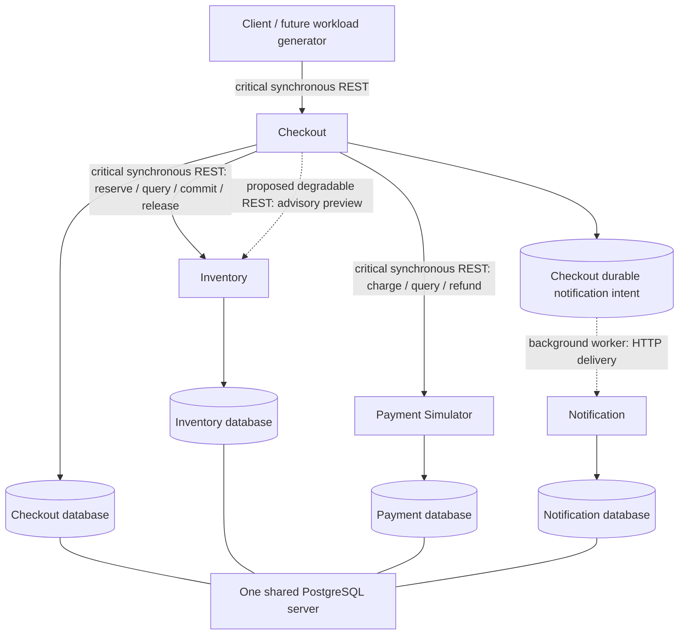
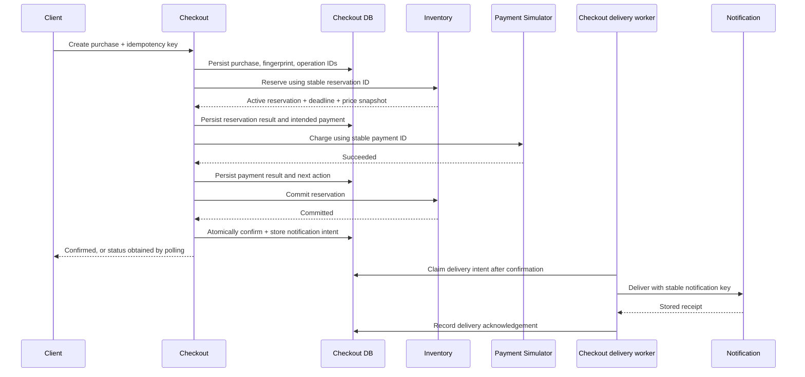
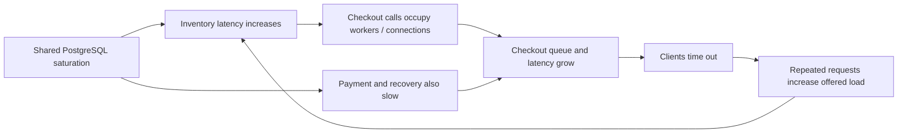

# Aegis architecture

Status: C accepted; D Payment/Notification implemented and verified, pending user acceptance. Only the foundation, Inventory read, Payment read and Notification receipt scope exists. The purchase/control-plane diagrams still describe future workflow. See README/DECISIONS for evidence.

## 1. Boundaries and ownership

**Approved:** four independent Java 21/Spring Boot applications, synchronous REST for critical remote commands and queries, durable Checkout orchestration, and local PostgreSQL transactions. No remote call runs inside a database transaction. A timeout establishes uncertainty, not failure.

| Service | Responsibilities and owned data | API boundary (see versioned contracts; execution scope below) | Dependencies and failures |
|---|---|---|---|
| Checkout | Purchase identity/details, client request fingerprint, workflow progress, operation IDs, notification intent | `POST /purchases`; `GET /purchases/{id}` | Inventory and Payment on critical path; Notification only through background delivery. Crashes, response loss, worker exhaustion. |
| Inventory | Fixed catalog/prices, available/reserved/sold balances, reservation states and deadlines | `PUT /reservations/{id}`; `GET /reservations/{id}`; idempotent commit/release commands | Own database only. Contention, expiry races, deadlocks, unavailable storage. |
| Payment Simulator | Immutable charge identity/amount/currency, synthetic outcome, refund identity/state | `PUT /payments/{id}`; `GET /payments/{id}`; create/query refund | Own database only. Decline, delayed completion, response loss, crash. No real payment provider. |
| Notification | Synthetic notification receipt and deduplication key | Submit/query notification receipt | Own database only. Slow receiver, outage, duplicates. |

Inventory is the approved catalog and price authority; Checkout stores the authoritative price snapshot returned during reservation, and Payment accepts only that immutable workflow amount. The initial configured currency is INR. Checkout initially stores requested SKU/quantity without a price; amount/currency become established together at reservation and then immutable. Money uses integer minor units and explicit currency; quantities are positive integers.

Separate processes are justified by independently failing dependencies and resource pools. Checkout exposes upstream amplification; Inventory supplies contention; Payment supplies uncertain side effects; Notification supplies a noncritical dependency. A modular monolith would simplify commerce engineering but would remove important network failure boundaries for this research.

## 2. Dependency graph



The notification edge is asynchronous relative to purchase completion, implemented by a future database-backed worker making an HTTP request. There is no message broker. The intent is stored in the Checkout database; the diagram separates it only to show delivery semantics.

**Approved:** separate databases and restricted runtime roles on one PostgreSQL server. Revoke cross-service connection/access privileges; do not rely on naming conventions. No cross-service SQL, foreign keys, shared entities, or distributed database transactions. Provisioning credentials are distinct from restricted runtime roles; exact privileges are deferred.

Logical ownership does not isolate CPU, disk, memory, connection capacity, or server availability. All services also share the local host and eventual container network. These common dependencies can propagate failure even without a direct REST edge. **Deferred option:** separate database instances and resource limits for experiments requiring stronger isolation.

## 3. Traffic and degradation boundaries

| Class | Operations | Safe future treatment | Must preserve |
|---|---|---|---|
| Critical synchronous | Purchase acceptance; reservation mutation; charge/refund mutation; authoritative status lookup | Reject new work explicitly before acceptance; bound waits and return honest pending/unavailable responses | Durable accepted work, operation identity, authoritative state, eventual reconciliation obligations |
| Degradable synchronous | Proposed advisory availability preview or optional summary enrichment | Clearly label stale/unknown data or omit optional enrichment | No stale preview may authorize a reservation, charge, or confirmation |
| Non-critical background | Notification delivery | Delay with bounded workers/backoff and visible backlog | Durable intent and deduplication; purchase result remains unchanged |
| Correctness-critical background | Reconciliation, compensation, reservation expiry | Schedule with protected progress and bounded resources | Never silently discard accepted mutations, unresolved outcomes, releases, or refunds |

The first three classes satisfy the research workload distinction; the fourth prevents treating all background work as expendable. Concrete degradable endpoints remain proposed. They should have an observable shared dependency cost if used to study contention, without becoming a required purchase prerequisite.

**Deferred to Phase 3 onward:** admission control, load shedding, concurrency limiting, bulkheads, and coordinated mitigation. These experiments can vary traffic mix and compare explicit admission rejection, reduced optional quality, backlog growth, and critical completion. Finite HTTP deadlines are basic transport hygiene, not authorization to add adaptive policies early. Every baseline retains identical business invariants.

## 4. Normal transaction sequence



Each service commits its own local state before acknowledging a mutation. Checkout records remote intent before sending it and progress afterward. A lost acknowledgement is resolved by querying/repeating the same operation identity. A request may return `202 Accepted` with a status location while durable processing continues; exact response envelopes are proposed for M1.2. Replaying a key identifies the same purchase, not necessarily an immutable snapshot of its evolving status.

## 5. Failure scenarios

| Scenario | Required future behavior |
|---|---|
| Payment definitively declined | Release reservation idempotently. Expose decline reason with cleanup pending until release/expiry is established. Mark terminal failure only when obligations are settled. |
| Charge succeeds but response is lost | Record unresolved payment outcome; query or repeat original payment ID. Never create a new charge identity. |
| Reservation definitively unavailable | Do not initiate payment. Return explicit purchase rejection/failure according to the finalized contract. |
| Reservation response lost | Query/repeat same reservation ID before deciding whether stock exists. |
| Reservation expires before payment succeeds or before commit | Do not reacquire stock silently. Refund successful charge and reconcile until the refund outcome is known. |
| Commit succeeds but response is lost | Query the reservation; do not refund on a timeout alone. Committed inventory plus successful payment permits confirmation. |
| Checkout crashes between any two steps | Recovery reads persisted intent and resolves remote state with original IDs. |
| Refund/release unavailable | Retain compensating state, next action, and visible reason. Escalation policy is deferred; do not claim settled failure. |
| Notification unavailable | Confirmed purchase stays confirmed. Retain delivery intent and expose backlog/failure. |

A payment lookup returning not-found does not prove that an earlier delayed request cannot arrive. Likewise, a cancellation/expiry decision in Checkout alone cannot fence a delayed charge. Retain the same ID and reconcile; future terminal-failure rules must either establish the authoritative remote outcome or introduce an explicitly reviewed fencing protocol. Automatic user cancellation is outside initial scope.

### Cascading-failure scenario (hypothetical, not a measurement)



Idempotency prevents duplicate business effects but does not eliminate duplicate request cost. Proposed advisory requests could add Inventory pressure; delayed notifications could also contend through shared infrastructure. Future experiments should compare explicit admission rejection, optional-work shedding, and dependency concurrency budgets, while protecting reconciliation. Do not intentionally weaken correctness or remove basic transport deadlines to manufacture a cascade.

## 6. Correctness invariants and verification

The invariants are approved baseline requirements. SQL/worker mechanisms below are proposed enforcement details for M1.3 review, not implemented algorithms.

| ID | Invariant | Proposed enforcement | Future verification |
|---|---|---|---|
| INV-01 | For each SKU, `initial + adjustments = available + reserved + sold`; all terms nonnegative. | Atomic balance/reservation updates and constraints in one transaction. No restocking semantics initially. | PostgreSQL balance checks after generated sequences and failures. |
| INV-02 | Concurrent reservations cannot allocate more than available stock. | Conditional decrement with sufficient-stock predicate; reservation creation in same transaction. | Race requests for final units with controlled barriers. |
| INV-03 | A scoped idempotency key identifies one immutable request and logical operation. | Unique key + canonical fingerprint; conflicting payload rejected. | Simultaneous duplicates, altered payload, crash after acceptance. |
| INV-04 | At most one successful logical charge per purchase; refund cannot exceed that charge. | Stable payment/refund identities, uniqueness, immutable amount/currency, atomic outcome updates. | Duplicate charge/refund submissions and lost responses. |
| INV-05 | Timeout never establishes payment decline, refund failure, or inventory failure. | Persist unresolved knowledge; query/repeat same operation. | Commit remote side effect and suppress response. |
| INV-06 | Reservation has one terminal outcome: committed, released, or expired. Commit requires active state before authoritative deadline. | Competing transitions lock/conditionally update same reservation; use a defined database-time deadline check. | Commit versus expiry/release race; crash after transition. |
| INV-07 | Confirmation requires successful payment and committed inventory; failed purchase must not conceal unresolved effects. | Explicit guarded workflow transitions; pending/compensating states persist until facts are established. | Illegal transition tests and full failure walkthrough. |
| INV-08 | Compensation and reconciliation remain durable and idempotent. | Persist next action; worker claims with ownership checks; remote deduplication despite overlapping workers. | Crash after each side effect, two workers, expired claim, compensation outage. |
| INV-09 | Notification failure cannot reverse confirmation or lose the delivery intent at confirmation. | Confirm + intent in one transaction; independent worker; receiver deduplication. | Receiver outage and delivery success followed by lost acknowledgement. |
| INV-10 | Controller actions cannot bypass business invariants. | Future allowlisted operational actions, bounds, validation, audit, safe fallback. | Phase 4 safety tests; never grant controller arbitrary commerce writes. |

Use real PostgreSQL to verify constraints and transaction behavior; mocks cannot establish locking semantics. Proposed starting isolation is `READ COMMITTED` with deliberate locks/conditional updates, not an assumption that isolation alone prevents races. Deadlock retries repeat the whole local transaction. Future multi-SKU work would require deterministic lock order and atomic all-or-nothing reservation, but is deferred.

Reservation expiry must be checked during commit even if the sweeper is delayed. The commit eligibility boundary is a serialized decision using fresh authoritative database time after contention waits, strictly before expiresAt. Define the exact SQL/locking linearization mechanism in M1.3 and test time advancing while waiting for a lock. Use injectable Java clocks for scheduling tests without substituting application time for authoritative expiry checks.

Worker leases do not guarantee a single active caller after pauses or lease expiry. Durable operation IDs and database transition guards must remain safe under overlap. Payment identity retention must outlive any response-cache retention; exact key scope, retention, and cleanup policy are deferred.

## 7. State and progress model

**Contract representation:** purchase states PROCESSING, COMPENSATING, CONFIRMED, FAILED, and REQUIRES_ATTENTION, with workflow step and knowledge/compensation flags. Future M1.3 obligation records are separate from the minimal M1.2 query representation. REQUIRES_ATTENTION is not settled failure and must not erase outstanding work. The normative snapshot matrix is in section 12 and encoded in the Checkout schema.

Reservation states: ACTIVE, COMMITTED, RELEASED, EXPIRED. Payment charge states: PENDING, SUCCEEDED, DECLINED; refund progress is separate. Checkout's unknown knowledge is distinct from Payment's authoritative state. Persist immutable purchase details, intended remote identities, last established outcomes, next action, and retry metadata.

Safety must hold during indefinite outages. Liveness assumes dependencies recover, durable state remains available, and workers receive execution time. No exactly-once network delivery is promised. One stored notification receipt per key is a simulator guarantee, not a claim about real email delivery.

## 8. Repository growth and dependency direction

**Accepted growth direction; create paths only in their authorized checkpoint:**

| Path | Purpose / earliest milestone |
|---|---|
| Root Maven parent and wrapper | Reactor/build governance, M1.2 |
| `services/{checkout-service,inventory-service,payment-simulator,notification-service}` | Independent service modules, M1.2 |
| `contracts/` | Service-owned wire specifications/examples, M1.2 when needed |
| `tests/integration/` | Public-interface end-to-end checks, M1.4 |
| `tests/performance/` | Workload/benchmark tooling, M3.3 |
| `deploy/local/` | Docker Compose, M1.4 |
| `deploy/observability/` | Phase 2 infrastructure |
| `control-plane/` | Telemetry aggregation, policies, safety, action adapters, Phase 4 |
| `ml/` | Offline training/experiments and model metadata, Phase 5 |
| `dashboard/` | React dashboard, M6.1 |
| `research/` | Experiment protocols/results when produced |

Service implementations must not depend on one another. Contracts contain transport schemas, not shared domain entities or repositories; begin without a shared Java DTO library. Within a service, separate domain rules, application workflow, and inbound/outbound adapters. The future control plane consumes telemetry/action interfaces, not commerce database internals. Offline Python code is not a production Java runtime dependency.

## 9. Risks and deferred design

Shared database contention limits fault isolation; separate instances remain possible. A small checkout graph favors interpretability but limits external validity. Durable workflow machinery costs complexity but is required to reason about crashes. Compensation may remain unresolved indefinitely; future operator tooling must be honest about that state. Optional traffic can confound results unless reported by class.

Deferred: deadline/retry budgets, exact persistence/transition algorithms, manual intervention, retention, optional advisory endpoint, physical database isolation, virtual threads, observability, fault injection, resilience libraries, controller algorithms, ML inference, and dashboard. Wire states, snapshot combinations, and errors are specified in the contracts; they do not implement those algorithms. See [DECISIONS.md](DECISIONS.md) and [ROADMAP.md](ROADMAP.md).

## 10. M1.2 contract scope and implementation boundary

OpenAPI 3.1.0 JSON documents: [Checkout](../contracts/checkout-v1.json), [Inventory](../contracts/inventory-v1.json), [Payment](../contracts/payment-v1.json), [Notification](../contracts/notification-v1.json). Each operation identifies its milestone; not-implemented metadata is the unchanged contract-review snapshot, not a current deployment inventory. JSON is an OpenAPI serialization; no YAML parser or Java code generator is required for preparation. There is no shared implementation module.

| Service | M1.2 endpoint scope | Reserved M1.3 endpoints |
|---|---|---|
| Checkout | GET `/api/v1/purchases/{purchaseId}` | POST `/api/v1/purchases` |
| Inventory | GET `/api/v1/items/{sku}` | PUT/GET `/api/v1/reservations/{reservationId}`; PUT commit/release subresources |
| Payment | GET `/api/v1/payments/{paymentId}` | PUT `/api/v1/payments/{paymentId}`; PUT/GET refund subresource |
| Notification | POST `/api/v1/notifications`; GET `/api/v1/notifications/{notificationId}` | Checkout delivery intent/worker, not another receiver endpoint |

M1.3 routes are contract reservations only; do not register stub handlers in M1.2. Optional advisory endpoints remain deferred. Catalog lookup returns a stock snapshot, never a promise of allocation. All business paths use `/api/v1`; resource IDs are UUIDs; monetary values use checked integer minor-unit arithmetic and INR. OpenAPI descriptions specify relational rules that cannot be fully captured by individual property schemas. Unknown request fields are rejected. RFC 9457-style Problem Details use `application/problem+json`, with Aegis `code` and optional `violations`; HTTP status and body status must agree. Do not leak internals.

### Notification idempotency: approved M1.2 exception

Notification identity is `notificationId`; semantic payload is parsed `purchaseId` and `kind`, not raw JSON bytes. First insertion returns 201 and Location. Same ID/identical semantic payload returns 200 with the original receipt and original `createdAt`. Same ID/conflicting payload returns 409 without replacing the row. UUID letter case, JSON formatting, and object property order do not change meaning. No separate idempotency header or table is needed.

The future implementation must enforce uniqueness in PostgreSQL and compare against the committed winner after an insert-if-absent conflict. A separate statement at READ COMMITTED can obtain the winner's committed row; do not continue querying in a transaction aborted by a uniqueness exception. Concurrent matching requests yield one 201 and successful replays 200; conflicting losers receive 409. Storage failures remain explicit and must not be fabricated as receipts. Verify concurrent same/different-payload requests with independent connections and controlled barriers. STORED is a local simulated receipt, not real delivery or proof of purchase confirmation. This exception brings receiver idempotency into M1.2, not purchase/payment/workflow idempotency.

### Minimal M1.2 persistence, separately from future schemas

| Service/table | M1.2 data and local constraints |
|---|---|
| Inventory `catalog_item` | SKU primary key, positive unit price, INR currency, nonnegative available quantity. Read-only business API; no reservation allocation counters/state machine needed yet. |
| Checkout `purchase` | UUID primary key, SKU, positive quantity, query-visible state/step and knowledge flags, nullable amount/currency pair, timestamps. Representation storage only; test fixtures supply records. No scheduler, claim, retry, obligation, or outbox fields. |
| Payment `payment` | UUID primary key, unique purchase ID, reservation ID, positive amount, INR, state, nullable decline code, timestamps. Query representation only; test fixtures supply outcomes. |
| Notification `notification_receipt` | UUID primary key, purchase ID, allowed kind, STORED state, createdAt. Semantic fields permit replay comparison without an idempotency table. |

There are no cross-service foreign keys; external identifiers are values only. M1.2 has no local relationship requiring a foreign key. Use primary/unique indexes for current queries; do not create speculative worker indexes. Initial catalog data must be explicitly identified as a local development/test fixture; no fabricated completed purchases/payments in production seed data.

**M1.3-only future schemas:** reservation records and stock conservation bookkeeping; refund records with local payment foreign key; purchase idempotency, obligations, recovery scheduling, and notification intent. Implementing these requires a separate reviewed design. The global invariants above remain the eventual system requirements; read-only M1.2 Inventory cannot mutate stock or demonstrate reservation concurrency yet.

Database names are `aegis_checkout`, `aegis_inventory`, `aegis_payment`, and `aegis_notification`, with separate `_app` runtime and `_migrator` roles. Migrators own objects; app roles receive only necessary access. Restrict cross-database connections/public privileges; no administrative runtime credentials. Independent service migrations use `db/migration`, versioned SQL, validation, and separate migration credentials. Do not rewrite applied migrations or use automatic ORM schema creation. No migration file is authorized in M1.2-A.

Manual development prerequisites are JDK 21, future Maven wrapper, a free Docker-compatible runtime for automated PostgreSQL tests, and separately provisioned local PostgreSQL for manual runs. Do not create a complete provisioning environment now. Four separate applications permit future independent CPU/memory, JDBC-pool and client limits; shared PostgreSQL still prevents physical database resource isolation. Full Compose and reproducibility are M1.4.

## 11. Accepted Maven foundation (M1.2-B, subsequently authorized)

Root `pom.xml` will be the `io.aegis:aegis-parent:0.1.0-SNAPSHOT` parent/aggregator with packaging `pom`, inheriting Boot dependency/plugin management and setting Java compiler release 21. It lists exactly four service modules: `services/checkout-service`, `services/inventory-service`, `services/payment-simulator`, and `services/notification-service`. `services/` and `contracts/` are directories, not extra Maven modules. No service depends on another service implementation. Each application declares its own dependencies and executable Boot packaging plugin; the root is not executable.

Each service will use `src/main/java/io/aegis/<service>/` for application, API, domain, application behavior, and persistence adapters; `src/main/resources/application.yml` and `db/migration/`; and service-owned `src/test/java` / `src/test/resources`. Create packages when needed rather than empty layers. Unit/API/PostgreSQL/startup tests remain in each service. The future wrapper includes Windows and Unix launchers and a pinned, checksum-verified Maven distribution. Exact tool/plugin versions must be verified from the effective build before claiming reproducibility.

Future service configuration keeps HTTP port, datasource credentials, migration credentials, pool sizes, and later client settings independent. Suggested local ports 8081/8082/8083/8084 for Checkout/Inventory/Payment/Notification are development defaults, not running listeners. Supply secrets externally. Do not create unused HTTP clients or add dependencies for future layers now.

M1.2 verification must cover API validation/Problem Details, migrations from an empty database, JDBC mappings and constraints, independent startup with PostgreSQL, runtime-role restrictions, and Notification concurrent matching/conflicting replays. Use test fixtures for Checkout/Payment; no automatic cross-service calls. No H2 substitution for PostgreSQL concurrency evidence, and no claim of process restart or system-wide recovery from a context startup test. Actual restart/end-to-end evidence remains M1.4.


## 12. Contract review clarifications (M1.2-A)

The following is a contract refinement for review, not application implementation. All four contracts retain the same architecture, paths, milestone labels, and not-implemented status. M1.2 fixtures must satisfy these constraints; examples are synthetic contract data, never production seeds or measurements.

### Checkout snapshot matrix

`paymentOutcomeKnown=true` means Checkout has durably observed a definitive charge outcome (SUCCEEDED or DECLINED). False includes no submitted charge, PENDING, or uncertain/lost responses; it never establishes decline or absence of a charge. A successful refund does not erase knowledge of a successful original charge.

`compensationPending=true` means inventory cleanup, refund, or uncertain-effects reconciliation remains outstanding. It does not mean only that a refund is in flight. False alone never establishes success. Store a coherent state/step/flags snapshot atomically in future implementation.

| State | Step | paymentOutcomeKnown | compensationPending | Price snapshot |
|---|---|---|---|---|
| PROCESSING | RESERVATION_PENDING | false | false | amount/currency both null |
| PROCESSING | PAYMENT_PENDING | false | false | positive amount + INR |
| PROCESSING | INVENTORY_COMMIT_PENDING | true | false | positive amount + INR; charge succeeded |
| COMPENSATING | COMPENSATION_PENDING | either | true | paired null or positive amount + INR; known payment requires price |
| CONFIRMED | SETTLED | true | false | positive amount + INR; charge succeeded and stock committed |
| FAILED | SETTLED | either | false | both null or positive amount + INR; known payment requires priced snapshot |
| REQUIRES_ATTENTION | RESERVATION_PENDING | false | false | both null |
| REQUIRES_ATTENTION | PAYMENT_PENDING | false | false | positive amount + INR |
| REQUIRES_ATTENTION | INVENTORY_COMMIT_PENDING | true | false | positive amount + INR; charge succeeded |
| REQUIRES_ATTENTION | COMPENSATION_PENDING | either | true | paired null or positive amount + INR; known payment requires price |

No other combinations are valid. SETTLED never appears on an in-progress or attention state. Payment discovery/step advancement should publish a coherent next snapshot rather than persist a known declined payment under PAYMENT_PENDING. Amount/currency are always present properties and either both null or both established; zero is not an unknown-price sentinel.

FAILED requires all obligations settled. With paymentOutcomeKnown=false it requires authoritative proof that no submitted/delayed charge can still take effect, not just a not-found lookup. With paymentOutcomeKnown=true it requires a definitive decline, or a successful charge fully compensated with inventory cleanup settled. These evidence rules are runtime invariants, not provable from response shape alone. Unknown payment during cleanup belongs to COMPENSATING or REQUIRES_ATTENTION with compensationPending=true. Cleanup for an unresolved reservation response may precede price discovery; then both price fields remain null and paymentOutcomeKnown=false. Such a snapshot must never imply that a charge can be issued without establishing price. Historical state/amount immutability and cross-service evidence remain M1.3 responsibilities.

### Payment and refund outcomes

Payment PENDING is durable but nonterminal: no definitive charge outcome is established, including retryable processing errors. SUCCEEDED and DECLINED are immutable definitive terminal outcomes. DECLINED guarantees that identity cannot later charge. `declineCode` is SIMULATED_DECLINE exactly for DECLINED and null otherwise; it is not a transport-error category. Caller uncertainty is distinct from the simulator's authoritative state.

Refund PENDING covers unresolved or retryable processing. SUCCEEDED is a definitive full refund. FAILED is a definitive terminal no-refund result with no delayed execution able to succeed for that identity. A timeout, storage outage, or retryable exception must not be recorded as FAILED. Matching replays return the original refund, never restart a terminal FAILED identity. FAILED leaves compensation outstanding and may require operator attention. Manual remediation is deferred; inventing another identity would violate the one-full-refund rule.

### Inventory time and terminal constraints

New commit eligibility is ACTIVE and `decisionTime < expiresAt`; equality is expired. Decision time comes from fresh authoritative database time at the serialized transition decision after any contention wait, not a stale transaction-start/application clock. A transition validly selected before expiry remains committed even if acknowledgement arrives after expiry. COMMITTED, RELEASED and EXPIRED are immutable and mutually exclusive.

A COMMITTED replay returns 200 even after expiry and moves no stock. Released/expired commits return distinct 409 codes. Reservation creation replay returns the original immutable snapshot and deadline, even for terminal reservations; it never allocates again or renews TTL. Release returns RELEASED before expiry or EXPIRED after expiry, preserving existing terminal results; COMMITTED release is a conflict. Detailed locking, expiry materialization and sweep scheduling remain M1.3. GET may show persisted ACTIVE after its deadline when cleanup lags; ACTIVE alone is never proof that commit is allowed.

### Monetary and error rules

Unit price, total, payment and refund amounts are positive signed int64 INR minor units, maximum 9223372036854775807. Quantity is a positive int32. Compute `unitPriceMinor * quantity` with checked int64 arithmetic before any allocation; no float conversion, wraparound, saturation or rounding. Invalid/out-of-range individual input returns 400 INVALID_REQUEST. Product overflow returns 400 MONETARY_OVERFLOW with no reservation/stock mutation. Matching identity replay returns the original snapshot without recomputing against a later catalog value. Cross-field product equality is a runtime test obligation; ordinary JSON Schema does not express arbitrary multiplication. If discovered after Checkout acceptance, failure is resolved through its durable M1.3 workflow, not by retroactively changing the original HTTP response.

Each contract contains a stable `x-aegis-error-codes` registry and response-specific schema enums and examples. Distinct conflicts include notification/key/payload reuse, existing purchase reservation/payment, insufficient stock, expired/released/committed reservation, refund identity reuse, existing refund, non-successful charge, and full-refund amount mismatch. Generic CONFLICT is no longer emitted. Unsupported currency is a 400 validation error (only INR is configured), not an unreachable currency-conflict case. Error status must match HTTP status; retryability and unknown outcomes must be assessed separately from the business code.

### Deferred M1.3 decisions

Exact transaction/locking SQL, transition linearization implementation, reservation duration, expiry cleanup, worker claims, retries/backoff, retention, fencing terminal failure, compensation scheduling, and operator remediation remain deferred. This refinement defines valid wire outcomes and safety boundaries only; it adds no schema migrations, state machines, workers or execution code.


## 13. Inventory C implementation

The catalog endpoint follows controller -> CatalogService -> CatalogRepository -> service-local PostgreSQL. JDBC uses a named SKU parameter. The service validates the exact contract SKU pattern before database access; controller maps the immutable item to the five response fields and a UTC read-attempt timestamp. Advice scoped to the catalog controller emits sanitized Problem Details for invalid SKU, missing item, unavailable storage, and unexpected failure. No reservation handlers are registered.

V1 creates only catalog_item with primary-key/format SKU checks, positive bigint price, explicit INR, and nonnegative bigint available_quantity. Store availability directly in this read-only milestone: no reservation/accounting fields exist from which to derive it. M1.3 will evolve accounting and introduce atomic guarded allocation and conservation tests; a stock read alone cannot prevent overselling. Do not mistake CHECK (available_quantity >= 0) for an allocation protocol.

Flyway is the sole initialization mechanism. Schema migration is always enabled; the explicit local profile adds a separate repeatable fixture with insert-if-absent semantics. No other service schema or production outcome data is touched. Runtime credentials can be SELECT-only; migrations use a separate owner. PostgreSQL tests exercise constraints and role restrictions with real connections. Spring JDBC keeps SQL/transaction behavior explicit without Hibernate's mapping/context lifecycle; no generic repository framework is introduced.


## 14. M1.2-D Payment and Notification implementation

Payment's controller delegates strict UUID validation and lookup to its application service and JDBC repository. Its immutable read model includes all nine contract fields, including an explicit null declineCode for PENDING/SUCCEEDED. DECLINED requires SIMULATED_DECLINE. A missing row is PAYMENT_NOT_FOUND, not a decline; storage failure is a sanitized SERVICE_UNAVAILABLE. There are no charge/refund handlers or other-service lookups.

Payment's V1 table has UUID payment identity, unique purchase identity, reservation UUID value (no cross-service FK), positive bigint amount, INR, valid state, decline consistency, and ordered non-null timestamps. The decline CHECK explicitly excludes NULL in DECLINED: PostgreSQL CHECK accepting UNKNOWN must not permit a missing definitive decline reason. The runtime role can only SELECT; isolated test resources supply all sample outcomes. Migration creates no payment data or refunds.

Notification's V1 table has UUID notification_id primary key, purchase UUID value, PURCHASE_CONFIRMED kind, STORED state, and database-generated timestamptz created_at. Runtime grants permit SELECT and INSERT of the three request fields only; no UPDATE/DELETE or audit-field insertion. No outbox, delivery system, retention cleanup or worker exists.

### Notification transaction boundary

NotificationService.store is a Spring-proxied READ COMMITTED transaction. The repository executes:

```sql
INSERT INTO notification_receipt (notification_id, purchase_id, kind)
VALUES (:id, :purchase, :kind)
ON CONFLICT (notification_id) DO NOTHING
RETURNING notification_id, purchase_id, kind, state, created_at;
```

If inserted, return the row with created=true; otherwise issue a separate SELECT by identity and compare parsed purchaseId/kind. Matching payload returns the existing row with created=false; mismatch throws the conflict and rolls back, without modifying the winner. The controller receives a result only after transaction commit, then returns 201 plus relative Location or 200. Commit/storage errors return sanitized failure with potentially unknown outcome, never fabricated success. Runtime immutability permissions and no deletion API keep the committed winner stable; privileged administrative mutation is outside this protocol's assumptions.

PostgreSQL uniqueness coordinates all instances. A conflict can become visible to ON CONFLICT before it is visible in that statement's snapshot; the following READ COMMITTED statement sees the now-committed winner. A single insert/select CTE could miss it, and a SELECT-before-INSERT check would race. Do not catch a raw uniqueness error and keep using an aborted transaction. Official references: [READ COMMITTED semantics](https://www.postgresql.org/docs/17/transaction-iso.html), [INSERT/ON CONFLICT](https://www.postgresql.org/docs/17/sql-insert.html).

Strict JSON parsing rejects missing/null/non-string/unknown fields before semantic UUID/kind validation. UUID comparison is value-based, accepting case differences while rejecting shortened UUID syntax. Whitespace/property order do not change payload meaning. Stable errors are INVALID_REQUEST, NOTIFICATION_NOT_FOUND and NOTIFICATION_ID_REUSED, with RFC-style status/code/detail/instance responses. STORED remains synthetic local receipt state, not delivery or purchase authority.

### Verification boundary

Two independent application contexts, HTTP servers and pools share a Testcontainers PostgreSQL database. Start gates exercise eight concurrent identical requests (one 201, seven 200) and eight conflicting requests (one 201, seven 409). A database-held uncommitted insert plus observed lock wait deterministically verifies winner commit and rollback cases without guessed sleeps. Separate connections inspect committed rows and original timestamp. Restart closes/recreates an application context and verifies persistence/replay. Dedicated disposable-database outages test read failures and notification transaction-start failures without introducing production fault injection. Unit mocks cover response translation, never concurrency acceptance.

These are service-level tests in one JVM, not a multi-process crash/deployment experiment. Runtime role grants prohibit cross-database connections and receipt mutation; migration credentials remain separate. Existing Inventory/Checkout and all contract files are unchanged. State transitions, charge/refund execution, orchestration/reconciliation, actual notification delivery and full Compose remain deferred. D is verified, not yet accepted by the user.
