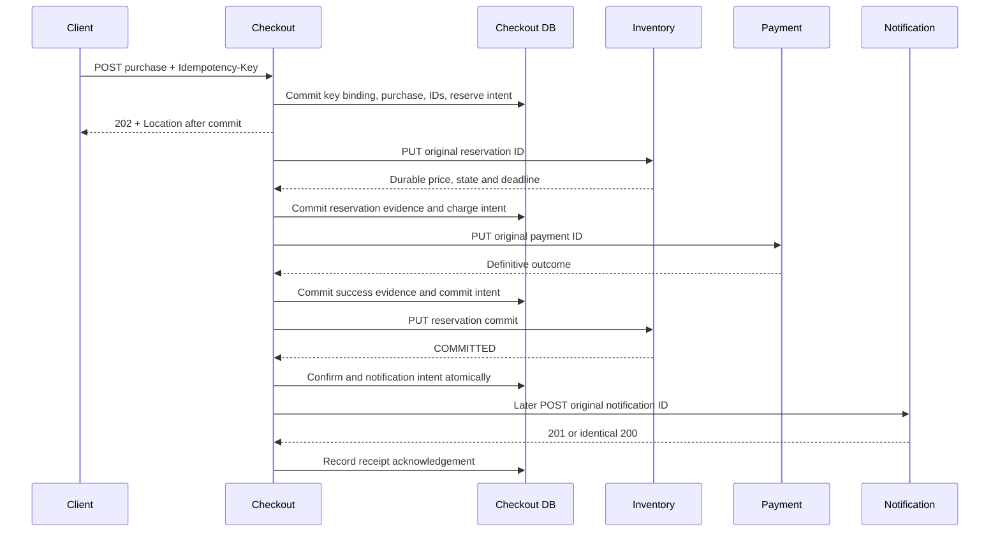
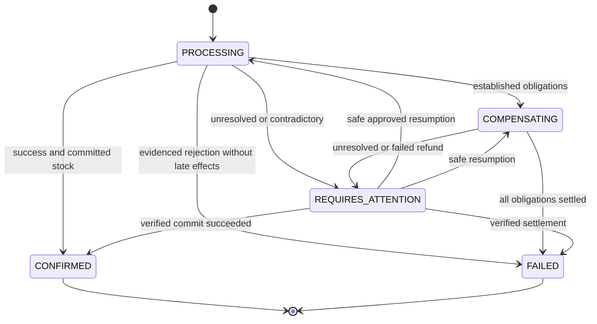

# M1.3-A distributed transaction and correctness design

**ACCEPTED ARCHITECTURAL BASELINE FOR M1.3-B (user authorization, 2026-10-24).** The user accepted the refined A recommendations and authorized B only. P-1..P-5 and CD-1/CD-3..CD-7 are the accepted baseline; CD-2 extension remains deferred. Numeric budgets remain provisional tuning assumptions, not measured guarantees. Historical proposal/review labels below describe the A preparation and are superseded by this acceptance record. Subsequently B was accepted for progression and the user authorized C Inventory execution only. See [DECISIONS.md](DECISIONS.md) D-017/D-018 for actual B/C implementation/evidence and limits; this file specifies the intended complete protocol, not current executable capability.

## 1. Baseline inspection and compatibility

Inspected AGENTS/README, four baseline documents, four OpenAPI JSON documents, four service implementations/configurations, schemas/Flyway migrations, relevant tests and history. Main includes E through PR #2; initial tree was clean. The five implemented routes are Checkout GET, Inventory GET, Payment GET and Notification POST/GET. Java 21, Boot 4.1.1, Maven 3.9.15, MVC/JDBC, Flyway and real PostgreSQL 17.11 tests remain unchanged. No shared Java business module or new dependency is needed.

**Already approved:** Checkout orchestration, Inventory price authority, one SKU/positive quantity, INR/minor units, stable identities, explicit uncertainty, refund after reservation expiry without silent replacement stock, local service transactions, independent notification delivery, restricted roles/separate databases and local/free infrastructure. Logical databases on one server do not provide physical resource isolation.

| Finding | Status / action |
|---|---|
| Documents still describe E as uncommitted/pending and F as unauthorized | Administrative drift corrected by this documentation change using the user's explicit M1.2 acceptance for progression. Preserve dated history. |
| Payment V1 orders timestamps but does not reject infinity | Still unresolved; new migration and tests required before writers. Do not rewrite applied V1. Checkout already checks finite timestamps. |
| Dedicated OpenAPI validation | Python openapi_spec_validator/jsonschema absent; no installation or full validation claimed. Structural/reference checks are partial. |
| Reservation rejection not specified as durable | Approval gate CD-1: delayed duplicate can otherwise allocate after failure. Propose service-local rejection retention. |
| Refund reason only RESERVATION_EXPIRED | CD-2 is conditional scope, not a minimal-protocol blocker: retain existing enum; unexplained RELEASED after success requires investigation. Extension deferred unless a reviewed release path is added. No JSON contract changed here. |
| Snapshot CHECKs cannot establish history/remote facts | Expected M1.2 boundary; future transition guards and durable evidence required, not a current workflow defect. |
| M1.2 operations still have not-implemented metadata | Historical contract-review snapshot explicitly documented in README; metadata synchronization proposed separately as CD-5. |

The 2026-10-21 F audit reported 166 passing tests (Checkout 62, Inventory 31, Payment 34, Notification 39; zero failures/errors/skips) and four packaged startup checks. This is historical evidence, not a new run on 2026-10-24. That audit corrected a stale agent-owned Java process; the earlier E cleanup report was incomplete. This checkpoint runs documentation consistency checks only. Timestamp hardening and full validation remain open; neither prevents design preparation, but both gate applicable later work.

### R-1: service trust and orchestration authority

**PENDING USER APPROVAL:** the initial environment is local, synthetic, single-client and trusted-service. These are protocol assumptions, not implemented access controls.

| Actor | Expected authority / invocation |
|---|---|
| Synthetic client, local developer or later workload generator | Submit purchases to Checkout with a stable key and query status/catalog. They do not drive Inventory or Payment mutations as part of a valid purchase trace. Multiple concurrent requests still belong to the same synthetic namespace. |
| Checkout forward/recovery workers | Sole expected initiators of reservation create/commit/release and charge/refund HTTP for purchases. Dispatch only immutable committed intents under current authority; retries keep IDs/payloads. |
| Inventory expiry worker | Performs only its own guarded expiry/stock-cleanup transaction; it is not a Checkout orchestrator and never calls Payment. |
| Checkout notification sender | Sends only the stable receipt intent atomically established at confirmation. Notification itself does not validate purchase success. |
| Local operator | May inspect diagnostics and review resumption. No direct business-table edits, invented refund IDs or mutation calls outside the protocol are assumed safe. Test-fixture provisioning is isolated from ordinary execution. No resumption API is implemented or authorized by this document. |
| Payment/Notification/Inventory services | Own and validate local identities, terminal guards and constraints. They do not read Checkout's database or acquire global orchestration authority. |

Checkout retains authority through its durable key binding, intent/evidence state machine and fenced transition writes, not by holding a distributed lock. Downstream APIs trust Checkout's supplied purchase/price associations; they cannot prove Inventory reservation evidence cryptographically or establish that their caller is Checkout. Runtime DB roles restrict SQL ownership, not HTTP caller identity.

Unauthenticated local callers can bypass expected actor roles, forge semantic requests or disrupt a workflow. Constraints still protect local invariants they actually enforce, but the design promises no protection against malicious/compromised services, privileged SQL mutation or forged evidence. Some interference is detectable as contradiction; not every forgery is detectable. Binding listeners to loopback/private local networks is a future deployment requirement, not an existing authentication guarantee. Public exposure, multi-tenant identity/key scope, authentication/authorization, service identity/mTLS, secret lifecycle, signed provenance and adversarial recovery are deferred security design gates before any untrusted deployment. Do not generalize this synthetic trust model to a real payment system.

## 2. Recommendation and alternatives

**P-1, pending approval:** PostgreSQL-backed Checkout-orchestrated Saga: durably accept -> reserve -> charge -> commit reservation -> confirm plus notification intent -> independently send receipt. Return POST 202 after Checkout acceptance commits, not after business completion. Each local effect commits independently; the global operation is not ACID.

| Alternative | Assessment |
|---|---|
| Reserve -> charge -> commit | Recommended: avoids charges for known stock shortages; expiry/refund obligation remains explicit. |
| Charge before reserve | Requires price discovery before reservation and causes avoidable refunds for insufficient stock. |
| Commit before charge | Decline would require reversing immutable COMMITTED stock, contrary to accepted reservation semantics. |
| Hold database transaction across HTTP | Long lock occupation still cannot make another service atomic; rejected. |
| Two-phase commit | No compelling need; coordinated prepared transactions add operational coupling and blocking recovery. |
| Broker choreography/framework | Unnecessary infrastructure for four-service learning scope; deferred. |

No transaction spans remote arrows. Missing acknowledgements leave existing intents recoverable. A lost acceptance response is retried using the original client key; a new key means a new logical purchase. Notification is independent of confirmation latency, but its durable intent is atomic with confirmation.

## 3. Effect protocol and compensation ordering

1. Validate client SKU/quantity; reject client prices. Atomically create scoped key binding, purchase, fixed operation IDs and reserve intent. Unique-key losers compare committed semantic payload. Matching replay returns 202/current Purchase and same Location; conflict is 409. An ambiguous local commit returns sanitized 503, resolved by the same key.
2. A fenced worker calls Inventory outside Checkout transactions. Record exact reservation identity, price, deadline and state before permitting charge. Inventory performs checked int64 multiplication before allocation. Only a durably bound rejection permits early failure; GET 404 or transport errors do not.
3. Before charge intent, require a validated ACTIVE response from the original reserve PUT or a subsequent GET, exact identity/purchase/SKU/quantity, checked positive price/currency/deadline, and no stronger terminal observation already recorded. If only an uncertain/failed result exists, do not publish charge. EXPIRED/RELEASED with no charge intent means no new charge and failure only after cleanup. Use an ACTIVE observation obtained in the same uninterrupted preparation attempt: the original reserve response can qualify, otherwise issue GET before the new intent transaction. A retry, restart, queue/backoff yield, attention pause or claim-generation change between observation and publication requires another GET; a previously stored ACTIVE row alone is not sufficient. Unobservable pauses/check-to-send delay remain possible, so no fixed freshness interval is a safety guarantee. Checkout clocks can conservatively delay dispatch, never prove Inventory eligibility.
4. Publish the exact immutable charge intent under current revision/lease before HTTP. Once published, it cannot be erased or treated as unsent: an old worker may still send it. A 404 lookup does not fence that delayed request.
5. **P-4:** resolve every issued charge using the same payment ID. If absent, repeat identical PUT even after reservation expiry; this can cause a synthetic charge followed by refund. This is the minimal settlement protocol without a new charge-cancellation fence and requires approval. Never invent DECLINED or a replacement ID. PENDING remains nonterminal.
6. Definitive decline -> known outcome plus cleanup obligation -> release original reservation -> FAILED only after cleanup. Success with inventory potentially committable -> publish commit intent -> query/repeat commit until authoritative terminal outcome.
7. **Once commit intent exists, never race it with release/refund.** Timeout stays INVENTORY_COMMIT_PENDING. Reconcile original commit; overdue ACTIVE is not terminal proof. COMMITTED plus charge success permits confirmation. EXPIRED permits the existing expiry refund. RELEASED after success is unexpected in the minimal trusted flow: attention/investigation, not automatic generic refund (see CD-2). A transient error never proves noncommit.
8. Success plus proven EXPIRED -> immutable full-refund intent with original amount/currency/RESERVATION_EXPIRED -> same-ID refund until SUCCEEDED or definitive FAILED. FAILED refund leaves REQUIRES_ATTENTION with compensation pending, never a fresh refund ID.
9. Confirm only with persisted SUCCEEDED charge, COMMITTED inventory, no refund intent and no unresolved obligation. Finalization and unique notification intent commit atomically. Delivery acknowledgement never changes purchase outcome.

Before charge intent, abandoning an uncertain reservation can enter unpriced compensation. Resolve the original creation through its PUT/ledger, then release if created. Stopping retries does not fence a delayed create. An automatic deadline cannot cancel an issued intent.

Unexpected COMMITTED state with no published commit intent, conflicting payloads, or incompatible observations require investigation. Do not refund committed stock, reacquire stock silently, overwrite facts or infer success from a receipt. No operator mutation API or unsafe force-FAILED action is proposed.

### R-3: ACTIVE-to-expiry-to-success race

An ACTIVE response establishes an authoritative observation at its read/creation instant, not an interval lock extending through Payment. Before publishing charge intent, a current fenced transaction must merge that response with current evidence/revision and validate the immutable price; terminal evidence dominates stale ACTIVE. No remote check can guarantee continued eligibility. If Inventory becomes terminal after the check but before intent publication, the request can still be charged; this is an allowed compensated race, not permission to renew/reallocate stock.

Trace: validated ACTIVE -> durable charge intent -> Inventory deadline passes -> same-ID synthetic charge succeeds -> commit samples fresh Inventory DB time and establishes EXPIRED/cleanup -> Checkout records success plus expiry -> same-ID full refund -> FAILED only after refund and cleanup evidence. If no charge intent was ever published, known expiry suppresses charge instead. If a commit response is lost, query/replay original commit before refund: it might have committed before expiry even though acknowledgement arrived later. No silent replacement reservation, renewal or failure inferred from timeouts.

## 4. Formal invariants and falsification tests

For SKU s, A=available, R=reserved, S=sold, T=initial stock. q(r)>0. No restocking/adjustment API. Evidence is a validated response for the persisted identity and immutable payload, recorded durably in Checkout; hypothetical fixtures are not evidence of executed effects.

| ID | Safety invariant | Specific future falsification test |
|---|---|---|
| I-1 | At every committed boundary A,R,S >= 0 and A+R+S=T. R=sum quantities of persisted ACTIVE (including overdue uncleaned); S=sum COMMITTED. Rejected requests contribute zero. | Race lifecycle operations; read counters/reservations in one consistent snapshot and compare conservation. |
| I-2 | Concurrent accepted reservations never allocate more than serialized available stock. | Barrier-start N buyers for last units; sum durable accepted quantities <= initial availability. |
| I-3 | One immutable reservation payload/deadline per ID, one request ID per purchase; commit movement at most once. | Two-instance duplicate creates/commits with lost responses; one movement, unchanged price/TTL. |
| I-4 | ACTIVE transitions to exactly one immutable COMMITTED/RELEASED/EXPIRED outcome. New commit requires fresh serialized Inventory DB decision time strictly before expiresAt. | Hold reservation and stock locks across deadline, then release; commit must fail at/after equality. Race all terminal commands and replay later. |
| I-5 | A durably rejected creation can never later allocate for that identity. | Commit shortage rejection, free stock, deliver paused duplicate PUT; same rejection/no allocation. |
| PAY-1 | One retained charge ID per purchase; terminal successful logical charge count <=1; immutable payload. | Duplicate/changed payloads and different IDs for one purchase concurrently; one winner and explicit conflicts. |
| PAY-2 | SUCCEEDED/DECLINED immutable; missing response, 404 and 5xx never establish decline. | Commit success then drop reply/restart; replay retains success and original amount. |
| PAY-3 | Refund links a SUCCEEDED charge, one refund ID per charge, equal full amount/currency; refunded amount <= charged amount. | Concurrent refunds, wrong parent/amount/reason/ID; one full refund or explicit conflict. |
| PAY-4 | Refund terminal outcome immutable; pending/timeout not FAILED; compensation replay cannot add another refund. | Lose refund response, replay/query repeatedly; transient errors must not produce terminal FAILED. |
| C-1 | Scoped client key binds one immutable SKU/quantity, purchase and operation-ID set. | Concurrent matching/conflicting POSTs, lost reply and restart; one durable binding/IDs. |
| C-2 | Every emitted mutation has durable prior intent; each transition has required evidence and current revision/lease authority. | Kill before send/after remote commit; recover original obligation; reject illegal/stale writes. |
| C-3 | CONFIRMED implies charge SUCCEEDED, inventory COMMITTED, no refund intent/unresolved compensation, and notification intent exists. | Attempt confirmation with every missing/conflicting fact; crash at finalization boundary. |
| C-4 | FAILED implies settled stock and either no charge intent ever existed, definitive decline, or successful charge fully refunded. No delayed command can introduce an unaccounted effect. | Resume a paused worker after FAILED; stale writes rejected and remote replays return retained terminal/rejected outcomes. |
| C-5 | Established price/currency and definitive payment knowledge never regress; every snapshot satisfies accepted matrix. | Generated transition histories; no priced/known -> null/unknown updates; contract-check each snapshot. |
| C-6 | One current claim generation; stale workers cannot observe/publish/renew/finalize in DB. | Pause A, reclaim as B, resume A at each persistence boundary; zero stale affected rows. |
| N-1 | Receiver failure cannot reverse confirmation; notification intent is atomic with confirmation. | Notification outage plus finalization crash; purchase confirmed and durable obligation retained. |
| N-2 | Same ID/payload preserves original receipt/time; conflict cannot overwrite; STORED is not external delivery. | Existing two-instance duplicate/conflict/restart cases plus dropped reply. |
| X-1 | No cross-service SQL/FKs/runtime DDL. Money is checked positive int64 INR; wire timestamps finite, ordered and representable. | Restricted-role/dependency tests, overflow boundaries, infinity/order/range checks. |

Safety holds through indefinite outages. **Conditional liveness:** due work eventually reaches a safe terminal outcome or visible attention if durable state survives, dependencies answer, workers run fairly and synthetic resolution supplies definitive outcomes. Overdue stock is eventually reclaimed if Inventory/DB workers recover; receipts are eventually acknowledged if sender/receiver recover. Permanent outage, lost durable state, contradictory facts and terminal FAILED refund prevent automatic business completion. No unconditional eventual refund or bounded completion is promised.

## 5. Durable state machine

Keep existing five states/five steps, ten state-step branches and sixteen complete flag/price shapes. Internal intent status is separate. K=paymentOutcomeKnown, B=compensationPending; paired price means both null or positive amount+INR. K=true requires a priced definitive charge observation; never store known decline in PAYMENT_PENDING. Refund does not erase charge knowledge. Timestamps are descriptive and ordered within a snapshot; they do not establish remote freshness, transition order or ownership.

| State / step | Meaning / entry | K,B,price | Durable evidence | Outgoing / recovery |
|---|---|---|---|---|
| PROCESSING / RESERVATION_PENDING | Accepted, price unknown | false,false,null | Key binding, IDs, reserve intent | Observed reservation -> payment; abandon uncertain create -> compensation; durable rejection/settled no-charge expiry -> FAILED; budget -> attention/reservation. Replay original reserve. |
| PROCESSING / PAYMENT_PENDING | Reservation price known; charge not definitive | false,false,priced | Reservation snapshot; charge intent if published | Success -> commit; decline -> compensation; proven uncommitted inventory with uncertain charge -> compensation; budget -> attention/payment. Resolve same charge. |
| PROCESSING / INVENTORY_COMMIT_PENDING | Successful charge, commit unresolved | true,false,priced | Success and commit intent | COMMITTED -> CONFIRMED; EXPIRED -> compensation; unexplained RELEASED -> attention/commit; uncertainty stays or escalates. No opposing commands. |
| COMPENSATING / COMPENSATION_PENDING | Cleanup/uncertain issued charge/refund outstanding; no potentially winning commit intent | either,true,paired | Exact obligations/observations; null price only if no known charge | Stay unresolved, FAILED only by C-4, or attention/compensation. No return to forward progress in minimal protocol. |
| CONFIRMED / SETTLED | Effects verified/finalized | true,false,priced | Success, committed stock, atomic notification intent | Terminal business state; independent notification acknowledgement only. |
| FAILED / SETTLED | No effect/cleanup obligation remains | either,false,paired | Retained rejection/no charge intent, or settled cleanup plus decline/full refund | Terminal. K=false only if charge intent never existed. No new intents. |
| REQUIRES_ATTENTION / RESERVATION_PENDING | Unresolved reserve / inconsistency | false,false,null | Original intent, error/attempt/age | GET-only while escalated; stronger facts adjust step or settle only with complete proof. PUT/new intents require reviewed resumption (R-2). Never new ID. |
| REQUIRES_ATTENTION / PAYMENT_PENDING | Charge unresolved / inconsistent | false,false,priced | Charge intent/observations/reason | GET-only may record known result and adjust attention step; business PUT/new commit/refund requires reviewed resumption. No failure from 404. |
| REQUIRES_ATTENTION / INVENTORY_COMMIT_PENDING | Success known; commit outstanding or paused before publication | true,false,priced | Success; commit intent if already published | Proven COMMITTED with prior intent -> CONFIRMED; EXPIRED -> compensation obligation. New commit/refund dispatch needs reviewed resumption; unexplained RELEASED stays investigated. |
| REQUIRES_ATTENTION / COMPENSATION_PENDING | Cleanup/refund cannot safely complete | either,true,paired | Retained obligations, budget/failed refund | GET-only, no side effects until reviewed resumption; FAILED only on proof-complete settlement. Terminal FAILED refund requires separately approved remedy. |

All unlisted edges forbidden. Same-state observation/retry updates cannot regress facts. Attention is nonterminal; read-only reconciliation may record stronger facts, but new side-effect dispatch after escalation requires safe approved resumption. Existing CHECKs constrain representation, not history: validate edge/evidence/revision under the workflow lock and update snapshot in the same transaction.

Diagram aggregates states; table restrictions are normative. Attention/payment cannot jump to confirmation without coherently recording successful payment/commit evidence.

### R-2: recovery classes and attention eligibility

The following internal classifications add no public states. They are **PENDING USER APPROVAL** and refine the table above where its wording was broad. Every durable observation, classification, edge, claim and resumption requires current owner/generation/revision and fresh lease validity after lock acquisition. Even read-only HTTP reconciliation needs a fenced local write to record its result; an expired worker cannot update facts.

| Internal classification | Public placement / eligibility | Automatic observations and effects | Resumption / stopping rule |
|---|---|---|---|
| TRANSIENT_RETRY | PROCESSING or COMPENSATING, within attempt/age limits, consistent facts | GET and same-ID already-published commands are eligible under normal guards; publish the next intent only when its prerequisites hold. This includes safe recovery after crash/response loss. | No human review needed while eligible. Permanent business outcome stops execution of that action; budget exhaustion changes classification atomically. |
| BUDGET_EXHAUSTED | REQUIRES_ATTENTION with current outstanding step/flags | Rate-limited GET only. May store stronger evidence and perform proof-complete local finalization; cannot publish/dispatch a new business command or replay a PUT, even if a matching replay is expected. | Reviewed resumption required before business side effects. A delayed old dispatch may still arrive; retain its intent and reconcile it. No budget-based FAILED. |
| RESUMPTION_REVIEW | REQUIRES_ATTENTION, dependency repaired or retry allowance proposed | Read/validate only until review is recorded. | Reviewed action binds expected revision, reason, original IDs/payload, consistent evidence, unresolved obligations, permitted action, and a new bounded retry allowance. Fenced transaction rechecks all prerequisites, reclaims ownership and returns to PROCESSING at the corresponding forward step or COMPENSATING for cleanup. Cannot reset facts, original age/history or identifiers. |
| DEFINITIVE_COMPENSATION_FAILURE | REQUIRES_ATTENTION / COMPENSATION_PENDING, B=true | GET of original refund/cleanup only; terminal FAILED refund is never re-executed by PUT and no alternate refund ID is allowed. | Manual investigation/remediation requires a separate approved protocol. Mere review/resume cannot change FAILED refund to success or erase purchase obligation. |
| CONTRADICTORY_EVIDENCE / MISSING_POLICY | REQUIRES_ATTENTION at schema-valid outstanding step | Quarantine the conflicting observation with diagnostics; no business dispatch or automatic terminal finalization. Bounded authoritative reads may gather evidence but do not select one conflicting terminal fact as truth. | Investigation and proof of correction required; no last-response-wins merge, direct SQL override or forced terminal purchase. Missing resolver metadata cannot be replaced with today's configuration. |

Public steps during attention remain honest while dispatch is paused:

| Attention step | Permitted reads / required evidence | Permitted local progress and business-effect boundary |
|---|---|---|
| RESERVATION_PENDING | Original reservation GET; 404 is inconclusive (no ledger-query API is added) | ACTIVE plus price -> attention/PAYMENT_PENDING with established price, no charge intent. Terminal cleanup or already recorded durable rejection plus no charge intent may settle FAILED. Any create/replay PUT or new charge requires reviewed resumption. |
| PAYMENT_PENDING | Original charge GET and reservation GET, validated immutable IDs/price | SUCCEEDED -> attention/INVENTORY_COMMIT_PENDING with K=true, commit intent possibly unissued; DECLINED or success+EXPIRED -> attention/COMPENSATION_PENDING with appropriate obligations. Cannot keep K=false merely to avoid changing step. Missing/PENDING stays unknown. No new commit/refund or charge PUT until reviewed resumption. |
| INVENTORY_COMMIT_PENDING | Original reservation/charge GET; prior commit intent required to explain COMMITTED | Matching success+COMMITTED and no conflict/refund/obligation may atomically confirm with the preallocated notification intent. EXPIRED records compensation obligation; refund dispatch still paused. ACTIVE/404 cannot resolve noncommit. COMMITTED without prior commit intent or unexplained RELEASED is investigated. |
| COMPENSATION_PENDING | Original reservation/charge/refund GET; preserve all intents | Proven cleanup plus no charge intent, decline, or full successful refund may settle FAILED under C-4. Otherwise remain attention. Terminal FAILED refund/contradiction blocks automatic resumption and finalization. |

Read-only reconciliation may persist required next-action obligations without publishing executable business intents. Local proof-complete finalization may create the already-planned notification obligation atomically with CONFIRMED; its independent sender follows its own eligibility policy and cannot alter purchase outcome. Global contradictions always disable automatic terminal finalization. A compensation transaction cannot revert to forward processing. No resumption API is implemented or authorized here; initial implementation can safely leave attention visible until an explicitly reviewed operational mechanism exists. Attention may persist indefinitely without violating safety or the conditional-liveness promise of reaching visible attention.

## 6. Identity, equivalence and retention (P-2)

Allocate separate UUID values once in Checkout acceptance: purchase, reservation, payment, refund, notification. They need not equal purchaseId; workers never regenerate them. Commit/release logical IDs are (reservationId,action), with optional internal audit UUIDs, not new wire IDs. Parsed UUID case irrelevant, SKU case significant, integer values exact. No in-memory mutex establishes uniqueness.

| Operation | Identity / semantic payload | Uniqueness / replay |
|---|---|---|
| Purchase POST | UUID key scoped to v1 creation/single synthetic client; SKU+quantity | Unique(scope,key), unique purchase binding. Match 202/current snapshot+same Location even terminal; conflict IDEMPOTENCY_KEY_REUSED. |
| Reserve PUT | reservationId; purchaseId+SKU+quantity | Request PK/unique purchase and reservation PK/unique purchase. New success 201; match 200 original price/TTL/current state; rejected request replays error. Conflicts RESERVATION_ID_REUSED/PURCHASE_RESERVATION_EXISTS. |
| Commit PUT | (reservationId,COMMIT), no body | Locked terminal transition. COMMITTED replay 200 even after expiry; expired/released 409; unknown 404 not a fence. |
| Release PUT | (reservationId,RELEASE), no body | Once-only reclaim; RELEASED/EXPIRED replay 200; COMMITTED 409; no renewal. |
| Charge PUT | paymentId; purchaseId+reservationId+amount+currency | Existing PK/unique purchase. 201 new, 200 matching current result; PAYMENT_ID_REUSED/PURCHASE_PAYMENT_EXISTS conflicts. |
| Refund PUT | refundId under paymentId; full amount+currency+reason | PK, unique paymentId, local FK to charge. 201 new/200 match; existing refund/identity/amount/state conflicts. Persist reason even though response omits it. |
| Receipt POST | notificationId; purchaseId+kind | Existing PK semantics: 201+Location new, 200 original receipt/time, 409 NOTIFICATION_ID_REUSED; no extra key header. |

Store canonical fields and compare them after uniqueness arbitration; a hash alone is not an equivalence proof. Concurrent losers read committed winner in a separate READ COMMITTED statement. Do not catch uniqueness error then continue in an aborted transaction; classify different-ID/same-purchase conflicts without overwriting.

Propose **no automatic deletion in initial M1.3**. Retain key bindings, immutable intents/results/rejections, reservation tombstones and charge/refund/receipt identities while delayed requests can be accepted. With no enforceable maximum stale-request lifetime, identity protection must be indefinite. Later archival must preserve replay/query protection or first establish an expiration/fencing protocol. Cache TTL cannot erase effect identity. Multi-client authentication remains out of scope.

Repeated delivery may invoke a handler many times; retained uniqueness/guards provide at most one logical effect and recovery supplies conditional progress. This is not distributed exactly-once execution.

## 7. Local transactions and concurrency

Use READ COMMITTED plus explicit locks/guards; isolation alone is insufficient. Never hold a transaction across HTTP. Roll back the entire local attempt, including counters. Deadlock/serialization retries start a fresh transaction with original identities; connection/commit loss is an unknown outcome resolved by replay/query. Never continue an aborted transaction.

### Inventory alternatives (P-3)

| Approach | Strength | Limitation / choice |
|---|---|---|
| Conditional UPDATE WHERE available >= quantity | Atomic allocation predicate; serializes hot stock | Still needs identity, reservation insert and expiry/terminal guards. Use defensively for creation. |
| Explicit row locks | Makes single-SKU lifecycle, payload and time decisions understandable | Serializes hot SKU, requires lock order. Recommended lifecycle starting point. |
| Optimistic version/CAS | Detects stale updates | More retries under hot-SKU contention; fresh expiry decision still needed. Not initial Inventory strategy. |

**Create transaction:** validate lexical input; arbitrate immutable request identity first using a service-local request ledger: PK reservationId, unique purchaseId, canonical payload, CREATED/REJECTED outcome and stable error code. These are request outcomes, not new wire Reservation states. Matching outcome returns without touching catalog or renewing TTL. New request locks catalog, obtains authoritative price, checks positive int64 product, checks stock, then creates ACTIVE and moves A-=q,R+=q in one commit. createdAt/expiresAt come from fresh Inventory DB time after contention. Missing SKU, overflow and insufficient stock commit REJECTED metadata without stock/reservation row. Invalid syntax and transient infrastructure errors are not cached business rejections.

Expected business rejection must return as a committed result, not an unchecked exception that rolls back its tombstone. HTTP follows commit. Crash before commit permits retry; lost commit acknowledgement replays the same result. GET may remain 404 for rejected creation since no Reservation exists; only the specified durable PUT result closes the attempted allocation. This proposed extra correctness metadata requires CD-1 approval, especially the original no-mutation wording.

**Lifecycle transaction:** lock existing reservation, inspect terminal state, then lock catalog when movement is needed. After *all* contention waits, sample `clock_timestamp()` in a new statement under these locks. ACTIVE with decisionTime < expiresAt commits (R-=q,S+=q); equality/later establishes EXPIRED and reclaims (R-=q,A+=q). Release before expiry yields RELEASED, otherwise EXPIRED. COMMITTED replay is 200 regardless of deadline; released/expired commits have distinct 409 codes. Terminal replay moves nothing. Commit-expiry conflict must be emitted only after cleanup commits, not thrown to roll it back. Expiry workers use this same routine/order. Overdue ACTIVE counts in R until cleaned. No renewal/replacement protocol.

Creation takes request arbitration then catalog and inserts a *new* reservation; it must not wait for an existing reservation after locking catalog. Replays resolve existing identity before stock locks. Commit/release/expiry lock reservation then catalog. Batches must not lock catalog and then another reservation. No opposite order or network under locks; retry whole transactions if deadlock nevertheless occurs. Detailed SQL/query plans and fresh-time-after-wait tests are implementation gates, not proofs supplied by this document.

Future counters R,S,T initialize R=S=0,T=existing available. Constraints use sufficiently wide arithmetic, e.g. numeric casts for sum validation, to avoid overflow in CHECK expressions. Cross-row equality with reservations requires transaction logic/tests, not a CHECK querying other rows. Update opt-in fixtures in the authorized future checkpoint so new catalog rows include a correct baseline; do not rewrite applied migrations. No adjustment/restock feature proposed.

### Payment/refunds (P-4)

### R-4: deterministic synthetic outcomes

**PENDING USER APPROVAL, minimal policy:** `AEGIS_SUCCESS_V1` resolves every valid newly admitted normal charge to SUCCEEDED and every eligible normal full refund to SUCCEEDED. It uses no randomness, UUID parity, wall-clock branch or live dependency to choose a business result. Business input validation still applies; an invalid refund is an HTTP business conflict, not a fabricated terminal FAILED refund. This is local synthetic accounting, not execution of real money or an external provider request.

Choose policy inputs only after identity arbitration and immutable request validation under the operation/parent locks. Persist operation ID, canonical payload, immutable policy version, scenario code (`NORMAL_SUCCESS` in normal execution) and deterministic chosen terminal outcome with creation metadata. Policy version defines an immutable mapping; version/scenario/outcome cannot be changed on replay. New identity admission and terminal resolution occur in one short transaction by default: its intermediate PENDING is uncommitted and not normally exposed. If this transaction rolls back, no durable choice/effect exists yet; if commit acknowledgement is lost, original-ID replay reads the committed choice/result. Concurrent duplicate losers use the winner's stored policy, never their own configuration.

| Existing operation | GET / matching PUT semantics |
|---|---|
| SUCCEEDED or DECLINED charge; SUCCEEDED or FAILED refund | GET/PUT return unchanged terminal result; no re-execution or new outcome choice. |
| PENDING with complete stored policy | GET only observes PENDING. Matching PUT locks/arbitrates the same row, validates payload and stored policy, then applies its chosen terminal transition once. A guarded PENDING -> terminal update and effect accounting commit together; duplicates observe the winner. |
| PENDING with missing, unknown or inconsistent policy metadata | Do not infer an outcome from current configuration or timestamps. Preserve PENDING; sanitized INTERNAL_ERROR for attempted resolution and investigation/attention at Checkout. Legacy/read-only M1.2 fixtures remain queryable; before writers, migration/data review must explicitly handle unsupported legacy pending rows rather than invent historical choices. |

Normal configuration initially selects only `AEGIS_SUCCESS_V1`; no public selector or scenario endpoint. A future policy version requires review, applies only to newly admitted operations and must retain interpreters for all retained pending versions. Existing terminal results never change. A process restart loads the stored policy, not a new random/configuration choice. Unknown policy is a data/implementation problem, not a genuine decline or refund failure. MISSING_POLICY is a local Payment diagnostic; Checkout cannot identify it from a generic sanitized500 alone. It treats that response as unresolved under ordinary retry/budget rules; investigation can later establish the specific reason without cross-service SQL in application code.

Test-only resolver implementations/fixtures may store `DECLINE_V1`, `REFUND_FAIL_V1` and a supported pending operation with its chosen result. Latches/isolated setup can expose committed PENDING to test recovery even though normal admission resolves in one transaction. Tests assert DECLINED with SIMULATED_DECLINE, terminal FAILED refund with outstanding compensation, pending resolution, duplicate terminal replay and a configuration-version change after pending admission. Test policies, deferred-resolution seams and fixture creation belong to test source/resources only; no ordinary JSON field/header, client namespace, normal profile or environment switch enables them. Unknown scenario fields remain rejected. Infrastructure exceptions roll back or leave unknown commit, never choose DECLINED/FAILED. No provider worker, payment randomness or production fault-control API is introduced.

Refund transaction locks its parent charge, requires SUCCEEDED and matching full amount/currency, arbitrates unique refund ID, stores immutable reason and resolves one synthetic refund. Keep original charge SUCCEEDED. Terminal FAILED refund stays FAILED; no replacement ID. Checkout must establish terminal uncommitted Inventory before issuing refund; Payment cannot validate another service's facts under this topology.

Before writers, new migrations validate existing rows and reject non-finite/out-of-wire-range timestamps and invalid ordering; never edit applied V1. Use version guards for history; timestamps are not fences. Keep updatedAt >= previous updatedAt/createdAt despite backward wall-clock movement. Multiplication belongs to Inventory; Payment validates exact positive int64 immutable inputs.

### Checkout (P-5)

Acceptance atomically records key binding, purchase, IDs and reserve intent. Later transactions lock workflow, check expected revision and current lease generation/owner/validity using fresh DB time, validate edge/evidence, publish next intent and update public snapshot coherently. HTTP data alone cannot authorize a stale worker to persist. Validate IDs/payload/price totals/currency/terminal consistency; contradictory evidence goes to attention, never overwrites stronger facts.

Proposed storage, names illustrative only: extend purchase with revision, claim generation/owner/until, scheduling/attempt/attention fields (or a one-to-one owned workflow row); a small immutable operation-intent/evidence/obligation table unique on (purchaseId,action); scoped client binding; unique notification intent per purchase/kind. Prefer a small current-state model over event sourcing. Local FKs are allowed within a service. Confirmation plus notification intent is one transaction. No migrations/tables are created in A.

Runtime grants expand only for exact approved local writes, never ownership/DDL/cross-DB access. Migrators stay separate. GET remains local. Four processes/pools permit independent future limits; shared PostgreSQL resources remain a limitation.

### Outdated-response merge guard (R-2 / critical revalidation)

A current worker must correlate each observation with the persisted ID, canonical payload and request/claim revision. It merges under the workflow lock against *current* evidence, not the state loaded before HTTP. Stale worker generations cannot persist any observation; a newer claim re-queries instead. Locally ordered attempt numbers and updatedAt do not prove remote freshness; the public contracts expose no universal remote version counter.

| Incoming observation vs stored evidence | Required handling |
|---|---|
| 404/timeout after a positive resource/result | Preserve established identity/outcome; absence cannot revoke a retained effect. Record diagnostic; unexpected loss of a retained terminal resource is investigated. |
| ACTIVE after terminal reservation | Ignore regressive lifecycle observation; keep terminal cleanup/commit proof. Do not issue charge or oppose commit based on it. |
| PENDING after definitive payment/refund | Keep definitive outcome/knowledge and flags. Do not restart an execution. |
| Same terminal result / payload | Idempotent corroboration; no extra movement, intent or refund. |
| Different terminal result, changed price/deadline/payload, wrong identity | Quarantine; no last-response-wins overwrite or automatic finalization; investigate. Wrong-ID response is never evidence for this purchase. |
| New stronger consistent fact | Persist evidence plus the coherent schema-valid state/step/flags in one fenced transaction. While attention-paused, add required obligation, not an executable new business intent. |

This closes the outdated-ACTIVE/PENDING-response gap without adding wire states/versions. Recheck terminal/intent guards immediately before any permitted dispatch; there remains a check-to-send window, handled by retained downstream identities and terminal constraints, not by claiming the check is a remote lock.

### Notification

Reuse implemented READ COMMITTED insert-if-absent plus fresh SELECT/compare. Sender preserves original ID/payload and durable acknowledgement. Lost acknowledgement retries the same ID. Receiver 409 is a sender-data conflict requiring attention, not permission for a new ID. Receipt retries cannot change purchase outcome.

### CD-1 delayed-retry exclusion argument

Assume a valid reservation request X reaches Inventory and insufficient stock is found under the catalog lock. X's canonical payload, purchase binding and REJECTED/INSUFFICIENT_STOCK outcome commit before its 409 acknowledgement. Only that contract-defined durable response (validated status/code/instance for the original request), not a proxy error or GET 404, permits Checkout to record rejection and settle a no-charge purchase.

Now stock increases or is released and a paused identical request Y arrives. Y first arbitrates X's retained request PK/unique purchase binding. If X is uncommitted, Y waits for commit/rollback; after X commits, Y reads the committed REJECTED row in a fresh snapshot, compares payload, returns the retained error and never enters catalog allocation. Different payload conflicts; a different reservation ID for the same purchase conflicts through the retained unique purchase binding. If X rolls back, no durable rejection may be acknowledged, so Checkout cannot safely finalize based on that failed attempt. Keeping the ledger forever (or preserving equivalent tombstones) prevents a later absence from reopening allocation. All writers must use the approved ledger protocol and contract version before enabling Checkout; identity arbitration is mandatory for every request, not a cache shortcut.

This is a protocol argument, not an executed proof/test. The falsifier remains I-5: commit rejection, change stock, resume an older request from another instance and assert no new reservation or stock movement. No new wire state is needed.

## 8. Failure and recovery matrix

All behavior below is proposed. Retry cells describe eligible ordinary recovery; R-2 attention/pause restrictions take precedence, so no cell permits automatic PUT dispatch after escalation. Purchase GET returns its current durable snapshot (200); downstream failures do not retroactively change accepted POST's 202. A request whose local storage is unavailable returns sanitized 503 with potentially unknown outcome. Safety references refer to section 4.

| Scenario / observable failure | Durable state | Immediate behavior | Permitted retry | Reconciliation | Compensation | Safety / expected outcome |
|---|---|---|---|---|---|---|
| 1. Duplicate/conflicting POST | Unique key/payload/original IDs | 202 match+same Location; 409 mismatch; 503 unknown acceptance commit | Same key/payload | Read committed winner | None from duplication | C-1: one purchase; replay current evolving snapshot |
| 2. Concurrent buyers exceed stock | Winners/counters; losing rejection tombstones | Inventory 201 winners/409 losers; purchase query remains available | Same ID repeats rejection; new purchase needs new key | Read retained outcome | None for rejected attempt | I-1/2/5: FAILED loser only after durable rejection/no charge intent |
| 3. Inventory unavailable before reserve | Original reserve intent, outcome unknown | PROCESSING/reservation, attention on budget | Original reservation ID | GET then matching PUT if absent/unknown | Abandon only after resolving/cleaning original create | C-2/4: pending until facts resolve |
| 4. Reserve commits, response lost | Inventory result; Checkout intent | Unpriced reserve snapshot until observed | Original GET/PUT | Original price/TTL/state, no reallocation | Release if abandoning or expired/no charge intent | I-3/C-2: forward or settled cleanup |
| 5. Reservation expires before payment | Distinguish no charge intent from already-issued intent | Pending/compensating until established | No new charge without intent; issued intent must resolve | Establish expired cleanup and charge outcome | Refund if issued charge succeeded | I-4/C-4: no failure solely from local clock |
| 6. Definitive decline | Decline evidence, priced cleanup obligation | COMPENSATING until cleanup | Release original ID; charge replay returns decline | Establish release/expiry | Stock cleanup, no refund | PAY-2/C-4: FAILED with K=true after settlement |
| 7. Charge success response lost | Charge intent, remote SUCCEEDED | PAYMENT_PENDING/attention; never decline | Original payment ID | GET/matching PUT | Commit if allowed; refund only proven EXPIRED; unexplained RELEASED -> attention | PAY-1/2: CONFIRMED or compensated FAILED |
| 8. Charge stays pending/uncertain | Original intent/schedule/unknown knowledge | PAYMENT_PENDING; compensation if Inventory terminal; attention on budget | Same ID, bounded scheduled attempts | Matching PUT may resolve pending; GET alone need not advance | Late success after expiry requires refund | PAY-2/C-4: visible unresolved, no false FAILED |
| 9. Crash after accepted intent | Key/purchase/intent survive | Lost response or last snapshot | Same key; claim original workflow | Due scan after restart | According to downstream facts | C-1/2: no lost accepted obligation |
| 10. Crash after reserve | Reserve intent; possibly price/charge intent | Last coherent snapshot | Original IDs according to durable intents | Re-read reservation and charge-intent existence | Cleanup if abandoning; resolve any issued charge | I-3/C-2: no new IDs/unsafe terminal claim |
| 11. Crash after charge success | Charge intent; maybe success/commit evidence | Last payment/commit snapshot | Original charge/commit IDs | Reconstruct observations under new generation | Only with immutable noncommit proof | C-3/PAY-2: confirm or compensate |
| 12. Commit fails after success | Charge success and commit intent | Commit-pending for transient/unknown; compensation for EXPIRED; unexplained RELEASED -> attention | Same commit while unknown | Original query/replay until terminal | Full refund for proven EXPIRED; RELEASED requires investigated/approved path; never timeout | I-4/C-3/4: confirm if COMMITTED; contradiction -> attention |
| 13. Refund times out | Refund intent/compensation obligation | COMPENSATING or attention, K remains true | Same refund ID/payload/reason | GET then matching PUT | Retain pending full refund | PAY-3/4: no failure from timeout |
| 14. Refund succeeds, response lost | Remote SUCCEEDED, unresolved local intent | Compensation until observed | Same refund query/replay | Persist success plus cleanup evidence | No additional refund | PAY-4/C-4: FAILED only when all settled |
| 15. Concurrent recovery workers | New claim generation, fixed intents | Stale local writes rejected | Current owner uses same IDs | Re-read current facts; stale caller discards result | No opposing command while commit may win | C-6/I-4/PAY-1: duplicate HTTP possible, stale advancement forbidden |
| 16. Notification unavailable | CONFIRMED plus notification intent | Purchase unchanged | Same ID, independent schedule | Query/replay receipt | None for purchase | N-1/2: confirmation survives; backlog remains |
| 17. DB commit succeeds but caller times out | Local effect may exist | 503/timeout, never fabricate rollback | Original key/operation ID | Query/replay retained result, including rejection | Only from authoritative facts | C-1/PAY-2/I-5: same logical effect |
| 18. Restart during compensation | Cleanup/refund IDs, evidence, next action | Last compensation/attention snapshot | New claim, original IDs | Resolve outstanding effects before terminal write | Preserve all obligations | C-2/4/PAY-4: FAILED if dependencies settle, otherwise attention |

Terminal refund FAILED, corrupted facts or lost durable data are not transient retry cases. Deleting records, clearing flags, a second refund identity or unproven FAILED is not recovery. A separately approved remedy is needed.

## 9. Recovery, fencing and scheduling (P-5)

Use PostgreSQL due-work discovery, not an in-memory queue. Poll a bounded set of due nonterminal rows with FOR UPDATE SKIP LOCKED; under each lock recheck eligibility/lease expiry using fresh DB time, increment monotonic generation, assign unique worker owner/deadline, commit. A new generation revokes earlier persistence authority; lease expiry alone is not ownership. Business due-work discovery excludes attention/dispatch-paused rows; separate read-reconciliation due eligibility may claim them for GET only, with the same generation/revision checks. Persist attention classification and pause eligibility so a restart cannot accidentally re-enable dispatch. Every new intent/dispatch rechecks pause state; read claims cannot become mutation authority without the reviewed resumption transaction. SKIP LOCKED suits work discovery, not complete inventory-balance reads.

Before observation, next-intent publication, renewal or finalization: lock/reload, check generation+owner+expected revision and fresh lease validity *after* lock acquisition. Zero affected rows means stop/reload. Never wrap an exhausted generation. No HTTP under these locks. Crash after claim becomes reclaimable; crash after intent leaves original action discoverable.

An expired worker can resume between its last check and HTTP send; Checkout CAS cannot recall that request. Remote safety additionally needs stable IDs/payloads, retained results/rejections, terminal guards and section 3's no-opposing-command rule. Example: A sends charge after B takes ownership. B resolves the same charge intent rather than FAILED from GET 404. A cannot publish new commit intent after losing its fence; if already published, B must resolve it before any release/refund. No new remote fence header/service coupling is required for this minimal protocol.

Persist nextAttemptAt, per-action attempts/first-attempt age and last sanitized error/classification/attention reason. Bounded exponential backoff with jitter uses durable attempt index and reproducible test randomness; persist chosen schedule. Bound HTTP/SQL waits, batch/pool sizes independently. This is recovery hygiene, not Phase 3 adaptive resilience.

### R-5: timing requirements versus tuning

**PENDING USER APPROVAL.** Correctness requires fresh Inventory DB time after locks, retained identities, bounded eligibility checks, current revision/generation and preserved uncertainty. None of the numeric defaults below establishes those properties or guarantees completion. Lease and reservation TTL serve different authorities; renewing a worker lease never renews stock.

| Parameter | Provisional configurable local default | Consistency / limitation |
|---|---|---|
| Reservation TTL | 30s from Inventory's serialized creation time | Allows an ordinary forward attempt, not an outage/retry guarantee. Checkout cannot extend it. |
| Worker lease / renewal | 15s / attempt renewal every 5s | Nominal renewal slack 10s; GC pauses, starvation or DB outage can still lose the lease. Expiry means stop local progression, never assume a remote effect failed. |
| HTTP bounds | Connect <=1s; response-read/idle <=3s; absolute attempt deadline <=4s including connection acquisition/connect/body | These are overlapping caps, not additive allowances. An idle timeout alone is insufficient. Cancelling a client wait does not prove server rollback. |
| Local DB acquisition / transaction | Pool acquisition <=0.5s; transaction wall budget <=2.5s, total local path <=3s | Transaction budget includes all statements, lock waits and commit wait; enforce remaining-deadline cancellation/rollback where possible. Commit can still become ambiguous. |
| SQL lock / statement | Lock wait <=1s; each statement <=2s and remaining transaction budget, whichever is shorter | Two 1s lock waits leave little budget; abort/retry whole attempt if budget exhausted. A per-statement limit alone does not bound the transaction. |
| Dispatch margin | Renew before dispatch unless at least 8s remain | Planned 4s HTTP + 3s local recording + 1s margin <15s. Check/renew may itself lose authority; verify fresh lease after waits. Not protection against arbitrary pauses. |
| Poll / worker capacity | Due poll up to1s; bounded claims/concurrent attempts | Bound pool contention and leave renewal capacity; no unbounded backlog claiming or remote call while holding DB transaction. Exact concurrency budget measured at F. |
| Backoff | base1s, double by attempt, cap30s; deterministic factor in [0.5,1] derived from operation ID+attempt | Persist schedule, cap arithmetic before overflow, reproducible tests. No action retry inline-loop; retries can outlive TTL. |
| Escalation | 20 dispatch attempts OR 10min unresolved action age, whichever first | Count persisted dispatch attempts, including ambiguous/crashed sends; retain original age. Do not count GET/claim polls as mutations; independent low-rate GET reconciliation defaults to30s. Threshold is an attention policy, not a failure verdict. |

These are planned bounded waits/caller budgets, not hard real-time guarantees about OS scheduling or when a remote server stops; remote commit after cancellation remains possible. A renewal path planned at <=3s fits nominal 10s slack. A just-renewed owner can normally fit one <=4s remote attempt and <=3s local record within15s; the nominal5s renewal cadence must have bounded scheduling/capacity and is not guaranteed by a blocked dispatch thread; slow scheduling/cancellation/commit ambiguity can still exceed the lease. The next local write must then fail fencing and the new owner reconciles. A normal charge/commit chain can fit30s, but multiple timeouts, lock contention, retry backoff, expiry scheduling or a clock fault can prevent it. No measured latency or probabilistic completion claim is made. Bound worker pressure so renewal does not wait indefinitely for a pool connection; validate budgets together before enabling writers/workers. Config changes affect new schedules, not immutable reservation deadlines, policy inputs or retained operation identities.

Escalation follows R-2: keep obligations, stop business dispatch, GET-only reconciliation, proof-complete local settlement or reviewed resumption. Definitive failed compensation/contradiction prohibits automatic execution. Notification has independent eligibility/scheduling and cannot exhaust correctness-critical capacity. Restart reconstructs work from DB. Inventory owns expiry; clock disagreement across services cannot authorize commitment. A badly wrong Inventory clock is outside any real-time expiry guarantee. These numbers remain provisional tuning assumptions, requiring measurement; safety must survive their violation.

## 10. Proposed API deltas - no contract edits in A

Keep /api/v1, UUIDs, existing public states, RFC 9457 errors and money schemas. All deltas below require review before contract edits or implementation.

| Delta | Proposal | Reason / compatibility |
|---|---|---|
| CD-1 required | Reservation PUT binds both successful and business-rejected valid requests to ID+purchase+payload permanently. Same rejection replays original status/code despite stock/catalog changes. GET 404 allowed when no Reservation exists. Clarify no stock/reservation side effect permits request-outcome metadata. | Prevents delayed allocation after FAILED. Existing ITEM_NOT_FOUND/MONETARY_OVERFLOW/INSUFFICIENT_STOCK suffice; changed payload conflicts. Unspecified retry semantics become explicit; no new Reservation state. Requires approval because no-mutation wording could otherwise exclude ledger. |
| CD-2 conditional / DEFER for minimal scope | Retain RESERVATION_EXPIRED. Add RESERVATION_UNCOMMITTED only if a separately approved, provenance-checked release-after-issued-charge path is needed. | Under the current trusted minimal protocol no normal successful-charge refund needs another reason. Unexplained RELEASED+success is investigation, not automatic refund. An eventual enum extension is compatible with the general compensation model but requires consumer review; timeout is never noncommit proof. |
| CD-3 required clarification | Matching charge/refund PUT returns current resource and may resolve PENDING once; terminal outcomes immutable. 201/200 describe identity creation/replay, not success. | Enables pending reconciliation without extra route/worker. No response shape change. 404/5xx not decline/refund failure. |
| CD-4 required before writers | Generated/persisted timestamps finite, ordered, supported RFC 3339 UTC instants; propose years 0001..9999. | format alone does not enforce DB finiteness/order. Payment needs new migration; other future fields same policy. No V1 rewrite. |
| CD-5 administrative proposal | Update metadata only for implemented M1.2 operations after review; retain M1.3 not-implemented until authorized verified code. | Accurate generated docs without claiming reserved handlers exist. |
| CD-6 clarification | Key scope v1 purchase creation/single synthetic client, semantic SKU+quantity, no automatic deletion; 202+same Location/current snapshot for matching terminal replay too. | Resolves retention/scope without authentication/new status. PurchaseRequest still rejects client amount/currency or unknown fields. |
| CD-7 clarification | Expiry conflict/release response only after EXPIRED cleanup commits; terminal replay never moves stock again; GET can show overdue ACTIVE. | Prevents exception handling from rolling expiry cleanup back. Equality expired; no renewed deadline. |

Other behavior remains: unknown resource 404; distinct identity/payload/business 409 codes; decline in resource state, not HTTP failure; wrong refund amount 409, unsupported currency/invalid input 400, checked overflow 400 MONETARY_OVERFLOW before allocation; 415 media, 500 unexpected and 503 unavailable/unknown commit. No Retry-After addition. Retry eligibility depends on facts, not status alone. Reserved-route clarification does not require a new version unless actual consumers require it; review generated clients before applying enum/semantic changes.

Explicit reservation-abort or charge-cancel fencing endpoints could avoid some create-then-release/late-charge-then-refund cost, but need new states/contracts and coordination. They are alternatives requiring separate review if P-4 is unacceptable, not part of the minimal proposal.

### Final P-1 through P-5 reassessment

All items remain **PENDING USER APPROVAL**. APPROVE/REVISE/DEFER below are reviewer recommendations, never records of user acceptance. Exact behavior is normative in the referenced sections; numerical tuning remains provisional.

| Item | Exact behavior / necessity | Compatibility / alternatives | Correctness and necessity class | Recommendation |
|---|---|---|---|---|
| P-1 | Sections2-3: record intent, reserve, charge, commit, atomic finalization/notification intent; no opposing command while commit can win | Existing states/routes and immutable reservation terminals preserved. Charge-first/commit-first and global transactions rejected in section2 | Mandatory effect ordering/atomic boundaries for selected Saga; notification delivery remains independent | APPROVE as refined |
| P-2 | Section6: fixed IDs, semantic key comparison, database arbitration, retain identities/rejections without automatic deletion | Existing UUID/replay contracts retained; finite retention only after an enforceable stale-request fence, not cache expiry | Mandatory duplicate/late-request protection; exact storage layout reviewed in B | APPROVE |
| P-3 | Section7: rejection ledger before allocation, conserved counters, ordered lifecycle locks and fresh DB time | CD-1 clarification required. Conditional-only and optimistic alternatives must supply the same identity/time/terminal guarantees | Guarantees mandatory; explicit-lock algorithm recommended simplest initial single-SKU implementation | APPROVE |
| P-4 | Sections3/7: issued synthetic charge resolved with original ID even after expiry; stored deterministic policy, then expiry refund if success | Existing payment/refund identities and terminal states retained, CD-3 clarified. Alternative real cancellation fence is additional protocol, not GET404 | Mandatory settlement under the no-fence synthetic model; late charge/refund causes no real-money effect here. Not a recommendation for real payment providers or user cancellation | APPROVE only for AEGIS synthetic scope as refined |
| P-5 | Sections5/7/9: retained evidence/obligations, monotone merges, current generation/revision, paused dispatch and reviewed resumption; independent receipt intent | Existing snapshot shape unchanged; internal metadata added later. In-memory locks or lease expiry alone insufficient; external scheduler unnecessary | Mandatory crash/stale-worker safety; exact SQL/claim layout tested later, timing numbers tunable | APPROVE as refined |

### Final CD-1 through CD-7 reassessment

| Item | Exact behavior / necessity | Compatibility / alternative | Correctness and necessity class | Recommendation |
|---|---|---|---|---|
| CD-1 | Retain every admitted valid create's successful/rejected outcome; replay rejected payload forever without allocation; error follows ledger commit | Same error codes/Reservation states; refine no-mutation wording to exclude allocation, not request metadata. Alternative explicit abort/fence is more protocol | Mandatory for safe early rejection settlement against delayed creates | APPROVE |
| CD-2 | No enum extension in minimal protocol. EXPIRED+success uses existing reason; unexplained RELEASED+success pauses/investigates | RESERVATION_UNCOMMITTED would be semantically valid only with a reviewed release-before-settlement path and proven release provenance. Additive enum can still break exhaustive clients; alternative is current enum plus attention | Optional future breadth, not necessary for normal minimal trace. Never mislabel RELEASED as EXPIRED | DEFER extension; APPROVE narrower baseline handling |
| CD-3 | GET read-only; matching PUT may resolve supported stored-policy PENDING once; terminal immutable; 201/200 not success verdicts | No new DTO/state/status; deterministic policy metadata internal. Alternative durable asynchronous executor unnecessary initially | Mandatory clarification for pending recovery and version-stable outcomes | APPROVE as refined |
| CD-4 | Finite, ordered, supported UTC wire timestamps, proposed years0001..9999; migrate/validate before writers | Current schema shapes retained; new versioned Payment constraint, no V1 rewrite. Deferring guard until after writers permits invalid rows | Mandatory data correctness; validation/tool results separately reported | APPROVE |
| CD-5 | Correct metadata only for implemented M1.2 operations, reserved operations remain unimplemented | Administrative metadata only; alternatively retain historical labels plus explicit README as today | Optional for effect safety, recommended for accurate generated docs; requires contract-edit approval | APPROVE administrative update |
| CD-6 | v1/single-client key scope, exact SKU/quantity, retained binding, same202/Location/current snapshot even terminal | Existing POST shape/status preserved. Multi-tenant scope/finite expiration requires later identity/security design | Mandatory defined scope/retention; no auth guarantee | APPROVE |
| CD-7 | Commit-expiry error and release response follow committed cleanup; terminal replay moves nothing; overdue ACTIVE may be read | Same methods/codes; no GET mutation or deadline renewal. Rolling cleanup back on business exception is incorrect | Mandatory expiry/stock/acknowledgement consistency | APPROVE |

No OpenAPI JSON changes are made. Deferring CD-2 is the smallest scope correction: it removes an unnecessary extension while retaining safe attention handling for unsupported released-after-success evidence. This refines the original draft's blanket RELEASED refund suggestion, not the approved public contract.

## 11. Deterministic test strategy - future authorized work

Section 4 maps every critical invariant to a falsification case. Implement those tests per checkpoint, not in A. Real PostgreSQL/Testcontainers establishes lock/constraint/commit behavior; no H2 or mocked repository substitutes for concurrency acceptance.

- State model: table-driven edges plus generated histories. Assert public matrix, monotonic price/knowledge, terminal guards and intent prerequisites after every persisted transition.
- Atomicity: interrupt between stock update/reservation insert and before/after commit; independent connections verify all-or-nothing visibility and conservation. Expected rejection/expiry conflicts must retain their intended committed metadata/cleanup.
- Contention: barrier-release independent clients; hold row locks and observe pg_stat_activity waiting before advancing. Test same/different identities across multiple instances, rollback and commit winners.
- Time: injectable scheduling clocks for units; real DB deadlines with held locks/observer for integration. Exact equality can use an explicitly test-only authoritative-decision-time seam; production uses fresh DB clock after locks, never Java clock. Test waits on both reservation and catalog rows.
- HTTP ambiguity: test-local proxy/latches let a real service commit, then suppress response. Replay original IDs and inspect committed data independently; exception is never rollback evidence.
- Fencing: pause A after claim, after intent and before/after send; reclaim as B, resume A. Assert stale DB writes fail, duplicate HTTP effects are safe, no opposing commands and no missing obligation. Include lease expiry during a lock wait.
- Compensation: decline cleanup, success after expiry, lost commit/refund replies, terminal FAILED refund, repeated release/refund and restart while compensating. Assert no refund while commit can win, no replacement identity and no unsupported terminal state.
- Process interruption: isolated service/harness JVM termination after intent, remote commit, observation and finalization; restart against retained disposable DB and recover original IDs/obligations. Full multi-service deployment/restart reproducibility remains M1.4; reusable exposed fault-injection infrastructure remains Phase 2.
- Isolation/regression: retain 166-test foundation, default-empty outcome DBs, migrations and denied cross-DB/DDL tests; expand grants only for approved writers. M1.2 reads stay local. New routes appear only in their authorized checkpoint.
- Contracts: when suitable approved tooling is available, record OpenAPI 3.1 validator name/version/results separately from runtime schema tests. Check all codes, nulls, money boundaries, UUID casing, Location and replay statuses; subset validation is not certification.

### Required refinement test traces (planned, not executed)

1. ACTIVE/charge/expiry race: record real reserve ACTIVE/price, gate the worker after its fenced charge-intent commit, wait on a DB observer proving Inventory time >=expiresAt, then release charge dispatch with deterministic success. Commit must establish EXPIRED/one stock reclaim, same-ID refund must settle once, and Checkout cannot become CONFIRMED. A second schedule releases before charge-intent publication with fresh terminal observation and verifies no charge is sent. No renewal/replacement stock.
2. Old response: gate an ACTIVE (or PENDING) response, record consistent terminal Inventory (or Payment) evidence via the current owner, then deliver the older response. Assert no evidence/flag regression or contrary intent. Repeat with a different terminal outcome and assert investigation, never last-response-wins.
3. Escalation: exhaust attempt/age allowance, restart process, deliver late success and try both current read-claim and stale dispatch paths. Only GET/local proof-complete settlement may proceed automatically; no PUT/new business intent until fenced reviewed resumption. Test all four attention steps, terminal FAILED refund and contradictory evidence separately.
4. Policy stability: persist supported PENDING with stored version/scenario/outcome, change normal configuration and restart, resolve through two concurrent PUTs. Old policy wins once. Missing policy stays pending/investigated; terminal replay does not rerun policy. Test-only decline/failure controls must be inaccessible through normal JSON/profiles/env.
5. Timing overrun: exceed lease via held DB lock/pool starvation or paused JVM, and exceed client deadline while remote commit succeeds. Assert current-generation checks reject stale writes, obligations survive and original IDs reconcile. Passing nominal timing values is not a correctness oracle.

Use time bounds to detect hangs, not establish race order: latches, observed locks and durable milestones establish order. Test-only interruption hooks are not production fault-injection APIs. Record seeds/environment; no correctness test is a performance/research result.

## 12. Proposed implementation checkpoints - all after A unauthorized

These subdivide existing M1.3 and do not add roadmap milestones.

| Checkpoint | Proposed scope / prerequisites | Required evidence |
|---|---|---|
| A current | This design/contract-delta review only | Explicit acceptance of protocol, invariants, unresolved choices |
| B | Approved contract refinements; Payment timestamp new migration; detailed persistence design/tooling as available | Reviewed artifact scope, schema/contract validation, no orchestration |
| C | Inventory outcomes/counters/reservations/lifecycle | Real contention, negative replay, expiry-after-lock and terminal race tests |
| D | Synthetic charge/full-refund writers | Duplicate/conflict/uncertainty/immutable outcome/refund tests |
| E | Checkout submission, durable intents/evidence and guarded forward/compensation | Acceptance atomicity, legal transitions, no unsafe finalization, completed downstream contracts |
| F | Checkout claims/recovery/scheduling, autonomous Inventory expiry and notification dispatch | Overlapping workers, crash points, unresolved compensation, receiver outage |
| G | Correctness acceptance audit | Full regressions/invariant histories/recovery evidence; user acceptance before M1.4 |

E can use bounded test-driven progression before autonomous F workers, but must persist obligations and not claim recovery implemented until F. C enforces expiry in command paths; F schedules autonomous cleanup without weakening that check. Refine checkpoint scope only by explicit review.

## 13. Approval questions, blockers and limits

1. Approve P-1 ordering and no opposing release/refund once commit intent can still win?
2. Approve P-2 fixed separate IDs, single-client key scope and no automatic identity deletion?
3. Approve P-3 locks/conditional allocation, conservation counters and durable rejection protocol CD-1? Without it, early FAILED is unsafe against delayed reserve creates.
4. Approve P-4 settlement of an issued but absent charge by original PUT even after expiry? If not, design explicit remote cancellation/fencing before writers; GET 404 is insufficient.
5. Approve deferring CD-2 extension with investigation for unsupported RELEASED+success; approve CD-3 deterministic pending resolution, CD-4 timestamps, CD-6 keys and CD-7 cleanup acknowledgement? CD-5 metadata requires separate contract-edit approval.
6. Approve P-5 revision/generation fencing and durable intent/evidence/notification storage? Concrete SQL/table/grant layout still needs checkpoint review.
7. Review TTL/lease/deadline/backoff/escalation defaults; calibrate before implementation. None is a measurement or safety proof.
8. Choose audited attention resumption and definitive FAILED-refund remediation before exposing operator writes. Default is visible unresolved state, no unsafe override; manual completion is not promised.
9. Complete timestamp hardening and full validation when available before applicable writers/contract acceptance; neither is silently treated as resolved here.

**Blocking later implementation:** pending semantic/contract approvals, safe negative-result retention and ambiguous-charge settlement, Payment finite-time hardening, concrete SQL/role/test review, and explicit next-checkpoint authorization. **Non-blocking for A review:** shared physical resources, missing dedicated validator, unmeasured numeric budgets and future test-seam/SQL details. The deterministic normal outcome policy and attention eligibility are now specified; implementation remains untested. No missing prerequisite prevents presenting this design. No application defect is repaired under this authorization.

### Revalidation of twelve critical properties

This is reasoned design review, not an executed model proof or concurrency test. The eighteen formal invariants and eighteen-case matrix remain the baseline; refinements narrow unsafe ambiguity without adding public states.

| Property | Reassessment / smallest correction / residual obligation |
|---|---|
| 1. Conservation / overselling | I-1/I-2 unchanged: one locked/conditional allocation transaction and once-only terminal movement. Cross-row aggregate tests still mandatory. |
| 2. Rejection retention | I-5 strengthened by the explicit arbitration-before-catalog exclusion argument; no acknowledged rejection before durable commit. Retention/unique binding mandatory. |
| 3. Duplicate purchases/payments | C-1/PAY-1 unchanged: semantic binding and downstream unique identities survive replays. Stored policy now freezes duplicate outcome choice. |
| 4. Delayed stale HTTP | C-6 rejects stale persistence, not remote arrival. Retained IDs/terminal guards and no opposing commands still protect late deliveries; pause does not recall them. |
| 5. Lost charge acknowledgement | PAY-2: GET404/timeout is not failure; same-ID synthetic settlement remains necessary. No second charge or DECLINED inference. |
| 6. Expiry after charge intent | R-3 explicitly allows this race and requires authoritative commit/expiry resolution then same-ID refund; ACTIVE checks cannot remove race. |
| 7. Commit uncertainty | Keep outstanding commit intent; query/replay until terminal, never refund/release based on timeout or stale ACTIVE. |
| 8. Refund idempotency/FAILED | Original ID/reason/policy retained; terminal FAILED blocks dispatch and retains B=true for manual investigation. No replacement refund. |
| 9. Fencing / generation | Recheck after waits and on every local write; attention/read claims cannot bypass pause. Renew-before-dispatch margin is tuning, not authority. |
| 10. Contradictory commands | No release/refund while commit can win. Unsupported RELEASED+success is investigated; generic refund reason is deferred. |
| 11. Terminal transition truth | R-2 fixes honest flag/step advancement while paused; merge stronger facts atomically and require all C-3/C-4 proof. Contradictions disable automatic finalization. |
| 12. Crash obligations | All intents, pause/classification/schedules and chosen outcomes survive restart. No memory-only recovery or retry-budget deletion. |

**Verdict:** ready to present for formal M1.3-A acceptance, not accepted automatically. No unresolved protocol contradiction is identified within the explicit synthetic/trusted fault model. Approval of mandatory P/CD semantics, attention/policy rules and provisional tuning is still required. Payment timestamp hardening is a B deliverable/prerequisite before D writers, not something to assume already done. Dedicated validation must be completed when suitable tooling is available, with limitations reported if still absent. The design is sufficiently specified to start the proposed B contracts/prerequisite checkpoint only after explicit authorization; concrete SQL and executable safety evidence remain gates at their later checkpoints. CD-2 and security/operator expansion are deferred scope, not hidden requirements for B.

## 14. AEGIS learning notes

1. Local ACID: Inventory may commit while Checkout loses the reply. Checkout rollback cannot undo that remote PostgreSQL commit; there is no atomic transaction across HTTP.
2. Saga vs two-phase commit: Aegis commits short independent steps and records their next action/compensation. It does not hold prepared transactions/locks across every service.
3. Idempotency vs exactly once: the same charge may reach Payment five times. Retained identity prevents five logical charges, not five handler executions or a guarantee that any request arrives.
4. Timeout ambiguity: Payment may already be SUCCEEDED. Calling it DECLINED would hide money needing stock commitment or refund.
5. Stable IDs: worker B queries A's original payment ID; a new identity risks another effect or conflicts with purchase uniqueness.
6. Fencing: paused A's generation 11 cannot finalize after B claims 12. Already sent HTTP still needs remote terminal/idempotency guards; a lease is not remote cancellation.
7. Compensation vs rollback: refund is a new durable operation that may time out/fail; original charge stays SUCCEEDED and compensation remains visible until settled.
8. Intent first: charge-before-recording can leave an untraceable effect after crash. Persisted ID/payload/obligation first gives recovery something to reconcile without an acknowledgement.

## 15. Sources and limits of inference

Official PostgreSQL 17 documentation checked 2026-10-24:

- [READ COMMITTED](https://www.postgresql.org/docs/17/transaction-iso.html): statement snapshots motivate a separate read after conflict arbitration.
- [Explicit locking](https://www.postgresql.org/docs/17/explicit-locking.html): row waits and deadlocks motivate consistent lock order.
- [Date/time functions](https://www.postgresql.org/docs/17/functions-datetime.html): transaction-start time differs from clock_timestamp; sample after waits.
- [SELECT and SKIP LOCKED](https://www.postgresql.org/docs/17/sql-select.html): skipping locks suits queue-like discovery rather than complete consistent balance reads.

The Saga algorithm, rejection ledger, budgets and checkpoint plan are project-specific proposals inferred from mechanisms and approved invariants, not proven algorithms or measurements supplied by those sources. Detailed SQL review and crash/concurrency tests remain mandatory.

## 16. M1.3-A acceptance checklist

- [x] Baseline sources, contracts, schemas, decisions and Git inspected; contradictions/follow-ups identified.
- [x] Approved decisions separated from pending proposals and deferred implementation.
- [x] Ordering alternatives, atomic boundaries and compensation rules documented.
- [x] Safety invariants have falsification tests; conditional liveness assumptions explicit.
- [x] Existing state/step/price/flag representation preserved; legal edges/evidence specified.
- [x] Identity, equivalence, duplicate conflict, rejection retention and timeout retry specified.
- [x] Local locks/time/rollback/fencing and their limits explained.
- [x] All eighteen failure scenarios and durable recovery obligations addressed.
- [x] Contract deltas identified; approved JSON and application behavior unchanged.
- [x] Checkpoint sequence, open questions and approval gates explicit.
- [x] R-1 through R-5 refined; twelve correctness properties and all P/CD recommendations reassessed, without runtime validation.
- [x] User accepted refined A baseline for B; CD-2 deferred and timing remains provisional.
- [x] B explicitly authorized; C and later remain unauthorized.

### Final refinement evidence (2026-10-24)

This refinement inspected the current uncommitted proposal, AGENTS/relevant baseline documents, all four contracts and compatible schema/transaction code. Existing six baseline-document changes were preserved. Only this design file was amended during the refinement; application source, SQL migrations and OpenAPI JSON remain unchanged. Documentation checks verify links/fences, fixed section/milestone structure, invariant/failure-case coverage and file hashes. No application test, runtime experiment, validator installation, benchmark, commit, push or merge was performed. Claims about stale responses, races, timing and deterministic policies above are reasoned requirements and planned falsifiers, not measured implementation behavior. All proposals remain PENDING USER APPROVAL.

### B persistence boundary

B adds additive V2 schemas and internal storage primitives only. Checkout stores canonical client bindings, fixed IDs, initial reserve intent, lease/revision metadata and guarded observations; it does not advance public purchase state. Inventory stores immutable rejected outcomes and reservation snapshots, but allocation, counters, authoritative expiry decisions and lifecycle writers remain C work. Payment stores pending admission with retained policy and full-refund metadata; no synthetic outcome executor exists yet. D must wrap admission/resolution in its enclosing short transaction for normal immediate terminal outcomes. Default databases gain no sample transactions. These foundations do not establish the complete Saga invariants by themselves.

## M1.3-C implementation trace (pending user acceptance)

The accepted section7 explicit-lock design is implemented for Inventory only. V3 adds a private immutable admission identity before the immutable CREATED/REJECTED result, so concurrent identities are arbitrated before catalog locks without introducing a public intermediate state. Both records and any allocation commit together. This preserves B's immutable result ledger. Counters and reservation state change atomically; deferred database checks compare counters to ACTIVE/COMMITTED rows. Commands take reservation then catalog locks and sample clock_timestamp() after all waits. Creation takes a new identity then catalog lock and samples the deadline once. There is no HTTP inside a transaction.

As section10 specifies, C enforces expiry on commands; F's autonomous cleanup remains unimplemented. GET and creation replay return persisted snapshots without extending deadlines or materializing expiry. A committed replay remains valid after expiry; commit against overdue ACTIVE establishes EXPIRED/reclamation before returning the accepted conflict. A delayed acknowledgement is not a failed mutation. Existing V2 snapshots cannot be automatically interpreted as allocated stock; V3 stops rather than inventing an accounting history. Test-only upgrade cases demonstrate this gate. No new public state, compensation rule or contract shape is introduced. Full Saga/worker/payment invariants remain future obligations; D-018 records C's executed evidence separately.
